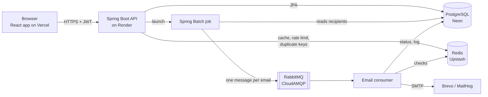
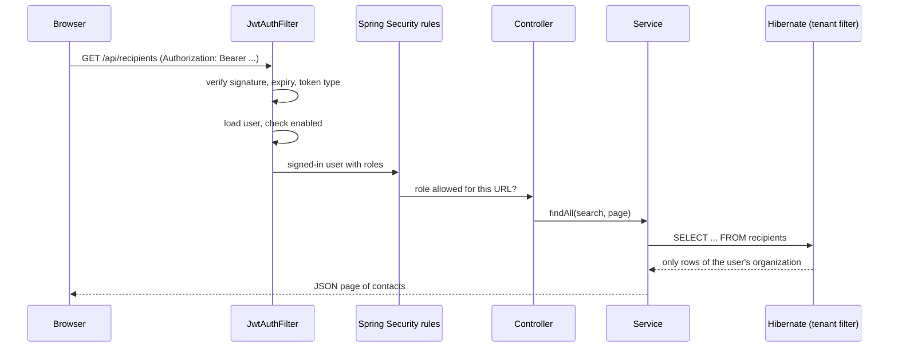
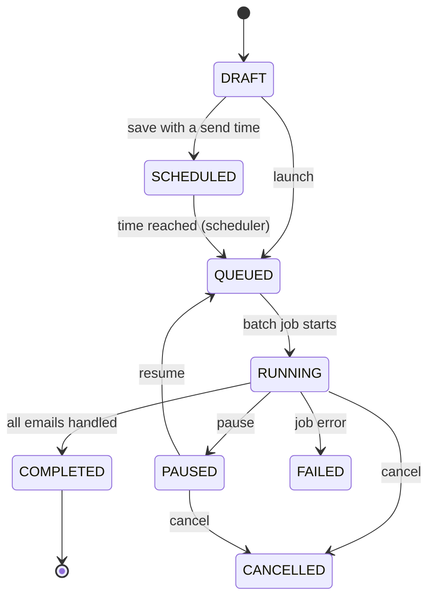
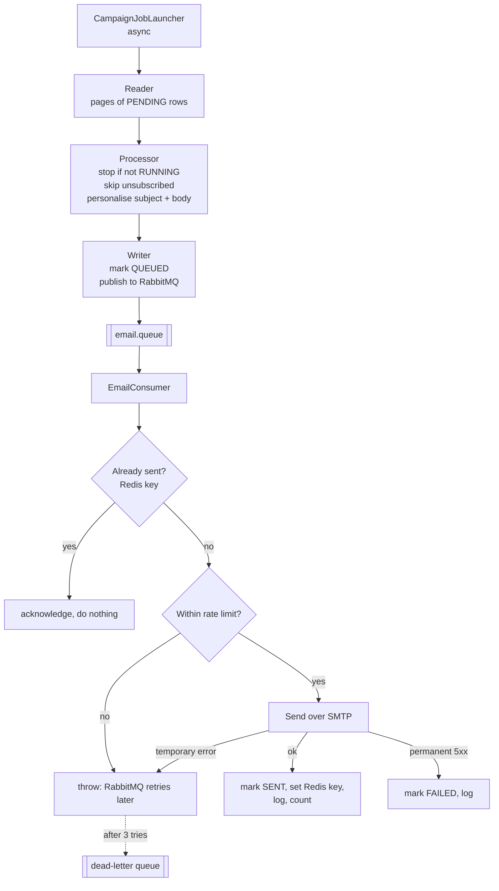
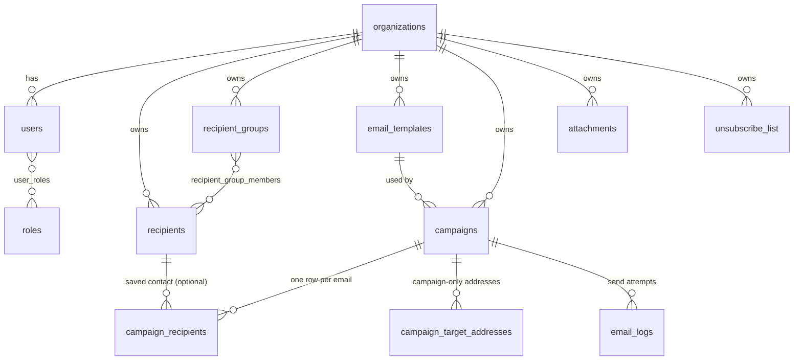
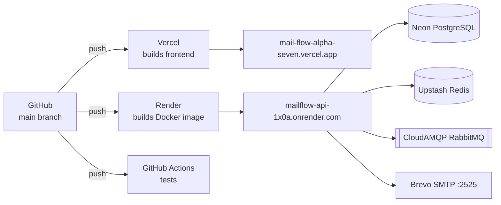

# MailFlow: Project Documentation

MailFlow is a web application for email marketing. A company signs up, imports its contacts from Excel or CSV, writes personalised email templates, and sends campaigns to thousands of people at a controlled rate. Each company works in its own private workspace, and its Admin decides who on the team may do what.

This document explains how the whole system is built: which technologies it uses and why, how each part works, how the parts fit together, how it is tested, and how it is deployed.

**Live deployment**

| Part | Address |
|---|---|
| Website | https://mail-flow-alpha-seven.vercel.app |
| Backend API | https://mailflow-api-1x0a.onrender.com |
| Source code | https://github.com/srijana533/MailFlow |

## Contents

1. [How this documentation is organised](#1-how-this-documentation-is-organised)
2. [Features](#2-features)
3. [Technology stack and why each part was chosen](#3-technology-stack-and-why-each-part-was-chosen)
4. [System architecture](#4-system-architecture)
5. [Repository layout](#5-repository-layout)
6. [Backend](#6-backend)
7. [Database design](#7-database-design)
8. [REST API](#8-rest-api)
9. [Frontend](#9-frontend)
10. [Configuration](#10-configuration)
11. [Testing](#11-testing)
12. [Deployment](#12-deployment)
13. [Security](#13-security)
14. [Problems solved during development](#14-problems-solved-during-development)
15. [Limitations and future work](#15-limitations-and-future-work)
16. [Glossary](#16-glossary)

---

## 1. How this documentation is organised

| Document | What it contains |
|---|---|
| **This file** | How the system works and why, with the important code excerpts. Start here. |
| [`reference/BACKEND_CODE_REFERENCE.md`](reference/BACKEND_CODE_REFERENCE.md) | One entry for each of the 135 backend classes: what it is for, its endpoints or methods. |
| [`reference/DATABASE_MIGRATIONS.md`](reference/DATABASE_MIGRATIONS.md) | Each database migration (V1 to V8) and the tables it creates. |
| [`appendix/A_BACKEND_SOURCE.md`](appendix/A_BACKEND_SOURCE.md) | The complete backend source code. |
| [`appendix/B_FRONTEND_SOURCE.md`](appendix/B_FRONTEND_SOURCE.md) | The complete frontend source code. |
| [`appendix/C_CONFIG_AND_DATABASE.md`](appendix/C_CONFIG_AND_DATABASE.md) | Settings, migrations, Docker, Render, Vercel and CI files. |
| [`appendix/D_BACKEND_TESTS.md`](appendix/D_BACKEND_TESTS.md) | The complete backend test code. |
| [`DEPLOYMENT.md`](DEPLOYMENT.md) | Step-by-step hosting guide. |
| [`EMAIL_SMTP_SETUP.md`](EMAIL_SMTP_SETUP.md) | Email server set-up for MailHog, Gmail and Brevo. |

The reference and appendix files are generated from the code by [`generate-reference.ps1`](generate-reference.ps1), so they always match it. After changing code, regenerate them:

```powershell
powershell -ExecutionPolicy Bypass -File docs/generate-reference.ps1
```

---

## 2. Features

**For a company**
- **Self sign-up.** Anyone creates a workspace in one step and becomes its Admin.
- **Private workspaces.** A company only ever sees its own contacts, groups, templates, campaigns, attachments, analytics and unsubscribe list.
- **Team and roles.** The Admin adds people as *Admin*, *Campaign manager* or *Viewer*, changes their role, or disables them. A disabled person is signed out immediately.

**Contacts**
- Import from `.xlsx`, `.xls` or `.csv`, with a preview that classifies every row as valid, invalid, a duplicate within the file, an existing contact, or unsubscribed, *before* anything is saved.
- Addresses are normalised (case, surrounding spaces, invisible characters), so `Ada@Test.com ` and `ada@test.com` are the same contact.
- Groups of contacts, search, and soft delete.

**Templates and campaigns**
- Templates with merge variables such as `{{FirstName}}` and `{{Company}}`. Missing values become empty text instead of breaking the email.
- A live preview that renders exactly what one recipient will receive.
- Campaigns with recipients from saved contacts, groups, an uploaded file, or addresses typed in once ("campaign-only" addresses that are not saved as contacts).
- Launch now or schedule for later; pause, resume and cancel while sending.
- Optional AI help ("Improve with AI", Google Gemini) to polish a draft. A person always reviews the result; nothing is sent automatically.

**Sending**
- Asynchronous: launching returns at once, and a background pipeline sends the emails.
- No duplicates: every recipient of a campaign has a unique key, checked before each send, so retries and restarts never email someone twice.
- Rate limited per campaign, to stay within the email provider's limits.
- Temporary failures are retried with back-off; permanent rejections are recorded and not retried.
- Per-campaign counters (sent, failed, skipped) and a dashboard with daily volume.

---

## 3. Technology stack and why each part was chosen

### Backend

| Technology | Used for | Why this choice |
|---|---|---|
| **Java 21** | Language | Long-term-support release, strong typing, records for data classes, mature libraries for every need here. |
| **Spring Boot 3.2** | Application framework | Sets up the web server, database access, security, messaging and scheduling with little configuration. Everything is configurable from environment variables, which hosting needs. |
| **Spring Web (MVC)** | REST API | Standard way to write HTTP endpoints in Spring. |
| **Spring Security 6** | Sign-in and permissions | Request filters for JWT, role rules per URL, and `@PreAuthorize` checks on methods. |
| **JJWT 0.12** | JSON Web Tokens | Signs and verifies the login tokens. Stateless tokens mean any server instance can check a request without shared session storage. |
| **BCrypt** (strength 12) | Password storage | Slow by design, so stolen password hashes are expensive to crack. |
| **Spring Data JPA + Hibernate 6.4** | Database access | Maps tables to Java classes and generates most queries. Hibernate's `@TenantId` is what keeps companies apart (section 6.3). |
| **PostgreSQL** | Database | Reliable relational database. JSONB columns hold each contact's custom fields. |
| **Flyway** | Database migrations | Versioned SQL scripts (V1 to V8) applied automatically on start-up, so every environment has the same schema. |
| **Spring Batch 5** | Reading a campaign's recipients in chunks | Processes large recipient lists page by page without loading them all into memory, with built-in retry, skip and restart. |
| **RabbitMQ** (Spring AMQP) | Email send queue | Separates "deciding what to send" from "sending". A slow mail server makes the queue grow instead of blocking the app, and failed messages are retried or moved to a dead-letter queue. |
| **Redis** | Rate limiting, duplicate protection, cache | Atomic counters shared by all workers. A Lua script makes "increment and check" one operation. |
| **Jakarta Mail** (Spring Mail) | Sending over SMTP | Standard SMTP client. The same code sends to MailHog locally and Brevo in production. |
| **Freemarker** | Personalising templates | Mature template engine. Users write simpler `{{FirstName}}`, which is converted internally. |
| **Apache POI, OpenCSV** | Reading Excel and CSV files | The standard Java libraries for these formats, including old `.xls` files. |
| **Quartz / Spring scheduling** | Starting scheduled campaigns | Checks every 30 seconds for campaigns whose time has come. |
| **Spring WebFlux `WebClient`** | Calling Google Gemini | Non-blocking HTTP client with timeouts. |
| **SpringDoc OpenAPI** | Swagger UI | Interactive API documentation, generated from the code. Off in production. |
| **Lombok, MapStruct** | Less boilerplate | Generates getters, builders and constructors. |
| **JUnit 5, Mockito, H2** | Tests | Unit tests with mocked dependencies, and real Hibernate queries against an in-memory database. |

### Frontend

| Technology | Used for | Why this choice |
|---|---|---|
| **React 18 + TypeScript** | User interface | Component-based UI; TypeScript catches mistakes at build time, e.g. a wrong field name in an API response. |
| **Vite 5** | Build tool and dev server | Very fast development server and an optimised production build. |
| **React Router 6** | Pages and URLs | Client-side navigation and protected routes. |
| **TanStack Query (React Query) 5** | Loading and caching server data | Handles loading states, caching, refetching and invalidation after changes, instead of hand-written state for each request. |
| **Zustand** | Sign-in state | A small store for the signed-in user and roles, simpler than Redux for this need. |
| **Axios** | HTTP client | Interceptors add the login token to every request and handle an expired session in one place. |
| **Tailwind CSS** | Styling | Utility classes keep styling consistent without separate CSS files per component. |
| **Recharts** | Charts | Dashboard and analytics charts. |
| **lucide-react, react-hot-toast, date-fns** | Icons, notifications, dates | Small, focused libraries. |
| **Vitest** | Frontend unit tests | Same configuration as Vite. |

### Infrastructure

| Technology | Used for | Why this choice |
|---|---|---|
| **Docker** | Packaging the backend | One image runs the same way locally, in CI and on Render. Multi-stage build: Maven builds, a small JRE image runs, as a non-root user. |
| **Docker Compose** | Local development | Starts PostgreSQL, Redis, RabbitMQ, MailHog, backend and frontend with one command. |
| **MailHog** | Local email testing | Catches every email locally and shows it in a web inbox, so nothing reaches real people during development. |
| **GitHub Actions** | Continuous integration | On every push: backend tests, Docker build, frontend type-check and build, security scan. |
| **Vercel** | Hosting the frontend | Serves the built website from a global CDN, free for this use. |
| **Render** | Hosting the backend | Runs the Docker image as a long-running service. Vercel can't run the backend, because it only runs short serverless functions. |
| **Neon, Upstash, CloudAMQP, Brevo** | Hosted PostgreSQL, Redis, RabbitMQ, SMTP | Managed services with free plans, so nothing has to be administered. |

---

## 4. System architecture



**Why this shape**
- **Launching is instant.** The API validates the campaign, creates one delivery row per recipient, and starts a background job. The person who clicked "Launch" doesn't wait for thousands of emails.
- **Sending can't overload anything.** The batch job puts one message per email on a queue. The consumer sends at a rate limited in Redis. If the mail server slows down, messages wait in the queue instead of piling up in memory.
- **Failures are contained.** A temporary SMTP error is retried with growing delays; a permanent rejection is recorded and the message is dropped; anything that keeps failing goes to a dead-letter queue for inspection.
- **No one gets two copies.** Each delivery has a unique key (`campaign_7_recipient_42`). The database row and a Redis key record that it was sent, so a retry or restart skips it.

**One request, from browser to database**



---

## 5. Repository layout

```text
mailer/
├── src/main/java/com/mailflow/
│   ├── MailFlowApplication.java   entry point
│   ├── auth/            sign-up, login, tokens, users, roles, team management
│   ├── organization/    the Organization (company workspace) entity
│   ├── tenant/          which company the current request belongs to
│   ├── security/        JWT filter, security rules, production checks
│   ├── recipient/       contacts, groups, Excel/CSV import and preview
│   ├── template/        templates, personalisation, preview rendering
│   ├── campaign/        campaigns, their recipients, lifecycle
│   ├── batch/           Spring Batch job that queues a campaign's emails
│   ├── queue/           RabbitMQ message and the consumer that sends
│   ├── email/           SMTP provider, rate limiter, unsubscribe list
│   ├── analytics/       email logs, dashboard and campaign statistics
│   ├── attachment/      file uploads
│   ├── ai/              optional Gemini/OpenAI drafting help
│   ├── scheduler/       starts scheduled campaigns
│   ├── config/          Redis, RabbitMQ, CORS, Freemarker, OpenAPI, settings
│   └── common/          errors, validation helpers, page responses
├── src/main/resources/
│   ├── application.yml        all settings, read from environment variables
│   ├── application-prod.yml   production overrides
│   └── db/migration/          Flyway V1–V8
├── src/test/java/             JUnit tests (247)
├── frontend/                  React app (src/, vercel.json, Dockerfile)
├── docs/                      this documentation
├── Dockerfile                 backend image
├── docker-compose.yml         full local stack
├── render.yaml                backend hosting (Render Blueprint)
└── .github/workflows/ci.yml   continuous integration
```

The backend is organised **by feature**: each package holds its own controller, service, repository, entities and DTOs. Everything about campaigns is in `campaign/`, rather than spread across `controllers/`, `services/` and so on.

Inside each feature, the same layers repeat:

| Layer | Job | Example |
|---|---|---|
| **Controller** | HTTP: parse the request, check roles, return JSON | `CampaignController` |
| **DTO** (`dto/`) | The shape of request and response bodies, with validation | `CampaignRequest`, `CampaignResponse` |
| **Service** | Business rules and transactions | `CampaignService.launch()` |
| **Repository** | Database queries | `CampaignRepository` |
| **Entity** | A table row as a Java object | `Campaign` |

Entities are never returned directly from the API. DTOs decide exactly which fields leave the server, so adding a column can't leak data by accident.

---

## 6. Backend

### 6.1 Start-up

`MailFlowApplication` starts Spring Boot. On start-up:

1. **Settings** are read from `application.yml`, with each value replaceable by an environment variable (`${DB_URL:...}`). With `SPRING_PROFILES_ACTIVE=prod`, `application-prod.yml` is applied on top.
2. **`ProductionSafetyCheck`** (production only) refuses to start if the login-token secret is missing or a default, the demo accounts are enabled, or `FRONTEND_URL` is missing, and names the variable to fix.
3. **`SmtpConfigValidator`** refuses to start if authenticated SMTP is on but the host, user or password is missing.
4. **Flyway** applies any new database migrations.
5. **`DemoAccountGuard`** disables the seeded demo accounts when `DEMO_ACCOUNTS_ENABLED=false`, because their passwords are published in the README.
6. The RabbitMQ consumer and the scheduler start.

### 6.2 Authentication and authorization

**Sign-up** (`AuthService.register`) creates an `Organization` and a `User` in it with the Admin roles, hashes the password with BCrypt, and returns tokens. **Login** checks the password through Spring Security's `AuthenticationManager`.

**Tokens.** Every successful sign-in returns two JWTs, signed with the secret in `JWT_SECRET` (HMAC-SHA256):

| Token | Lifetime | Used for |
|---|---|---|
| Access token (`typ: access`) | 1 hour | Sent as `Authorization: Bearer ...` on every API request |
| Refresh token (`typ: refresh`) | 7 days | Only for `POST /api/auth/refresh` to get new tokens |

The `typ` claim stops a long-lived refresh token from being used as an access token:

```java
// JwtAuthFilter: a request is signed in only if all of these hold
if (jwtService.isTokenValid(token, userDetails)       // signature, expiry, same user
        && !jwtService.isRefreshToken(token)          // not a refresh token
        && userDetails.isEnabled()                    // not disabled by the Admin
        && userDetails.isAccountNonLocked()) {        // not deleted
    SecurityContextHolder.getContext().setAuthentication(authToken);
}
```

The user is loaded from the database on every request, rather than trusted from the token. So when an Admin disables someone, that person's existing tokens stop working on their next request, not when the token expires.

**Roles** are levels; each includes the ones below (`RoleLevels`):

| Role | Can do |
|---|---|
| `ADMIN` | Everything, plus the Team page |
| `CAMPAIGN_MANAGER` | Create, edit, delete and send campaigns; manage contacts, groups, templates and attachments |
| `VIEWER` | Read campaigns, contacts, templates and analytics |

Permissions are enforced in two places:

1. **URL rules** in `SecurityConfig`: for example, `GET /api/campaigns/**` needs any role, other methods on it need `ADMIN` or `CAMPAIGN_MANAGER`, and `/api/team/**` needs `ADMIN`.
2. **Method rules** with `@PreAuthorize("hasAnyRole('ADMIN','CAMPAIGN_MANAGER')")` on controller methods, so a rule is visible next to the code it protects.

The frontend hides buttons a role can't use (`lib/roles.ts`), but that is only convenience. The server checks every request.

**Error codes.** A request with no valid token gets **401**, and the frontend then opens the login page. A signed-in user without the role gets **403**, and the frontend shows "You don't have permission". `/error` is open in `SecurityConfig`. Otherwise Spring's internal error dispatch, which carries no token, turned every 403 into a 401 and signed users out.

**Team management** (`TeamService`, `/api/team`): every query includes the Admin's organization, so a user ID from another company is reported as "not found". An Admin can't change their own role or disable themselves, which guarantees each company keeps an Admin.

### 6.3 Company workspaces (multi-tenancy)

This is the most important design decision for letting many companies share one installation safely.

**The model.** An `Organization` row is a company. Every `User` belongs to one. Each company-owned table has an `organization_id` column: `recipients`, `recipient_groups`, `email_templates`, `campaigns`, `attachments` and `unsubscribe_list`. Delivery rows, target addresses and logs belong to a campaign, so they inherit its company.

**Automatic filtering with Hibernate.** Company-owned entities mark that column with `@TenantId`:

```java
@org.hibernate.annotations.TenantId
@Column(name = "organization_id", nullable = false, updatable = false)
private Long organizationId;
```

`TenantIdentifierResolver` tells Hibernate the current company: the signed-in user's organization. Hibernate then:
- adds `WHERE organization_id = ?` to every query on these entities, and
- fills in `organization_id` on every new row.

A developer writing a new query can't forget the company filter.

```java
public class TenantIdentifierResolver implements CurrentTenantIdentifierResolver<Long> {
    public Long resolveCurrentTenantIdentifier() {
        return TenantContext.currentOrganizationId().orElse(TenantContext.ROOT);
    }
    public boolean isRoot(Long tenantId) { return TenantContext.ROOT.equals(tenantId); }
}
```

**Code without a signed-in user.** The batch job, the RabbitMQ consumer and the scheduler run in the background, where nobody is signed in. They run as the special **ROOT** tenant, which Hibernate doesn't filter, and every query they make passes the campaign's organization explicitly:

```java
// RecipientRepository: used by a launch, which may come from the scheduler
@Query("""
       SELECT r FROM Recipient r
       WHERE r.id IN :ids AND r.organizationId = :orgId
         AND r.deletedAt IS NULL AND r.status = 'ACTIVE'
       """)
List<Recipient> findByIdsIn(@Param("orgId") Long organizationId, @Param("ids") Collection<Long> ids);
```

This prevents an attack where company B creates a campaign listing company A's contact IDs and schedules it. The scheduler would otherwise resolve those IDs without any filter. With the explicit organization, B's campaign finds nobody and can't be launched. The live smoke test checks exactly this.

**Lookups by ID.** Hibernate's filter covers queries but not every direct load by primary key (`findById`). Every web-facing lookup by ID therefore uses a query method instead, such as `findOneById` or `findByIdAndDeletedAtIsNull`, which the filter does cover. `TenantIsolationTest` proves that company A asking for company B's campaign gets nothing.

**Caches.** Cached lookups are keyed with the organization, so one company can never be served another company's cached template or contact:

```java
@Cacheable(value = "templates", key = "T(com.mailflow.tenant.TenantContext).key(#id)")  // "7:42"
```

**Unsubscribes** are per company. An address that opts out of company A's emails can still receive company B's. That matches how email consent works, because each company is a separate sender. The unsubscribe list is written by public links and by the batch job, where nobody is signed in, so it uses an explicit `organizationId` column instead of `@TenantId`.

**Existing data.** Migration `V8__organizations.sql` creates the `Default` organization and moves all earlier data into it. An existing installation keeps working after the upgrade.

### 6.4 Contacts and import

`RecipientImportService` reads uploads with **OpenCSV** (CSV, including semicolon-separated files, a byte-order mark and Windows-1252 text) and **Apache POI** (`.xlsx` and `.xls`). Headers are matched case-insensitively with aliases, e.g. "E-mail" and "Email address" both mean the email column.

The **preview** (`POST /api/recipients/import/excel/preview`) saves nothing. It classifies each row:

| Status | Meaning |
|---|---|
| `VALID` | A new address that can be imported |
| `EXISTING` | Already a contact; it will be reused, not duplicated |
| `DUPLICATE` | Appears earlier in the same file |
| `INVALID` | Not a valid email address |
| `SKIPPED` | Unsubscribed, or belongs to an inactive or deleted contact; the reason is given |

`EmailValidator.normalize` lower-cases addresses and removes surrounding and invisible characters (non-breaking spaces, zero-width spaces). The same rule is used for import, campaigns, delivery keys and the unsubscribe list, so the same person always matches.

Contacts are **soft-deleted**: `deleted_at` is set instead of removing the row, so past campaign history stays intact.

### 6.5 Templates and personalisation

Users write `{{FirstName}}`. `TemplateEngineService` converts this to Freemarker's `${FirstName}` and renders it.

`PersonalizationModel` is the single place that decides which variables exist: name, email, first and last name, company, course, every custom field from the import, capitalised aliases, and extras such as role, phone and location. Missing values become empty text. Both the real send and the preview endpoint use it, so **the preview shows exactly what the recipient will get**.

### 6.6 Campaign lifecycle



**Launch** (`CampaignService.launch`):
1. Checks there is content (the campaign's own body, or a template with a body), a valid subject, a sender address, and at least one chosen recipient.
2. Resolves recipients from the chosen contacts, groups and campaign-only addresses, all limited to the campaign's company.
3. Leaves out inactive, deleted and unsubscribed addresses, and any address that already has a row in this campaign.
4. Creates one `campaign_recipients` row per address, with status `PENDING` and a unique idempotency key.
5. Sets the campaign to `QUEUED` and starts the batch job **after the database transaction commits**, so the job never reads rows that aren't saved yet.

Campaigns are soft-deleted too, and a campaign that is still sending can't be deleted.

### 6.7 The sending pipeline



**Spring Batch job** (`CampaignBatchConfig`):
- The **reader** pages through the campaign's `PENDING` rows, 50 at a time (`BATCH_CHUNK_SIZE`), so memory use doesn't depend on campaign size.
- The **processor** re-reads the campaign's status first. If the campaign was paused, cancelled or deleted meanwhile, it stops. It skips unsubscribed addresses, then renders the personalised subject and body.
- The **writer** marks each row `QUEUED` *before* publishing its message. A row that is already `QUEUED` or `SENT` isn't published again. If publishing fails, the transaction rolls the marks back.
- The step is *fault tolerant*: mail and connection errors are retried (`BATCH_MAX_RETRIES`), and bad rows are skipped up to a limit (`BATCH_SKIP_LIMIT`).

**RabbitMQ** (`RabbitMQConfig`): one direct exchange, `email.queue` for work, and `email.dead-letter.queue` for messages that keep failing. The consumer retries 3 times with growing delays (2 s, then doubling, up to 10 s).

**Consumer** (`EmailConsumer`), for each message:
1. **Duplicate check.** If Redis holds `email:sent:<idempotencyKey>`, the email was already sent, and the message is acknowledged without sending. The key lives 48 hours.
2. **Campaign check.** A paused campaign's message goes back to `PENDING`, so resuming sends it. A cancelled or deleted campaign's message is marked `SKIPPED`.
3. **Rate limit.** `RateLimiterService.tryAcquire(campaignId)` runs a Lua script in Redis that increments a counter for the current minute and checks it against `EMAIL_RATE_LIMIT`. One atomic operation means several consumers can't exceed the limit together. Over the limit, the message is retried later.
4. **Send** through `EmailProvider`.
5. **Record** the result: the row's status, the Redis key, an `email_logs` entry (written asynchronously), and the campaign's counters.

The `campaign_recipients.idempotency_key` column is unique in the database, which guarantees one row (and so at most one email) per recipient per campaign.

### 6.8 Email providers

`EmailProviderConfig` picks the provider from `EMAIL_MODE`:
- `development`: `DevEmailProvider` only writes emails to the log.
- `production`: `SmtpEmailProvider` sends over SMTP: MailHog locally, Brevo or Gmail when hosted.

**Which address goes in "From"** (`EMAIL_FROM_POLICY`):
- `smtp-username` (for Gmail): From is the Gmail account, as Gmail requires.
- `platform` (for Brevo and SES): From is `EMAIL_FROM_ADDRESS`, a sender verified with the provider. The campaign's own sender address becomes **Reply-To**, so replies reach the company that sent the campaign. This is needed because Brevo rejects unverified senders, and many companies share one Brevo account.

`SmtpSslTrustConfig` sets the TLS trust option only when `SMTP_SSL_TRUST` has a value. An empty value made Jakarta Mail trust *no* server.

### 6.9 Analytics

`AnalyticsService` computes the dashboard (campaign counts, total sent and failed, success rate, contact count), per-campaign statistics (throughput per minute, duration), and daily sent volume. Every figure is limited to the user's company and leaves out deleted campaigns.

### 6.10 AI-assisted drafting (optional)

`AiController` → `AiConfig` picks a provider: `GeminiContentProvider`, `OpenAiContentProvider`, or `NoOpAiContentProvider` when AI is off. `AiPromptBuilder` tells the model to keep the meaning, facts, links and `{{variables}}`, not to invent details, and to answer in strict JSON. The key comes only from the environment and is never logged or sent to the browser. With AI off, the endpoints answer **503** and the rest of the app is unaffected.

### 6.11 Errors and validation

Request bodies are validated with Jakarta Validation annotations on DTOs, e.g. `@NotBlank`, `@Email`, `@Size`. `GlobalExceptionHandler` turns every error into the same JSON shape (`ApiError`):

```json
{ "status": 400, "error": "VALIDATION_ERROR", "message": "...", "path": "/api/recipients",
  "fieldErrors": [ { "field": "email", "message": "must be a well-formed email address" } ] }
```

| Exception | HTTP status |
|---|---|
| `ValidationException`, invalid body | 400 |
| Bad credentials | 401 `UNAUTHORIZED` |
| Disabled account | 401 `ACCOUNT_DISABLED` |
| Missing role | 403 `FORBIDDEN` |
| `ResourceNotFoundException` (including another company's data) | 404 |
| `ConflictException`, duplicate data, concurrent edit | 409 |
| Upload too large | 413 |
| Anything unexpected | 500, with a generic message; details go only to the log |

### 6.12 Caching

`RedisConfig` defines caches with lifetimes: templates (30 min), campaigns (5 min), recipients (15 min), unsubscribed (1 day). Writes evict the affected entries. Keys include the organization (section 6.3).

---

## 7. Database design



| Table | Holds | Notable columns and rules |
|---|---|---|
| `organizations` | Company workspaces | `name` |
| `users` | People who sign in | `email` unique across the system; `password_hash` (BCrypt); `enabled`; `organization_id` |
| `roles`, `user_roles` | Role names and who has them | ADMIN, CAMPAIGN_MANAGER, VIEWER |
| `recipients` | Contacts | `email` unique **per organization**; `custom_fields` JSONB; `status`; `deleted_at` |
| `recipient_groups`, `recipient_group_members` | Named lists of contacts | |
| `email_templates` | Reusable content | `subject`, `html_body`, `plain_body`, `variables` |
| `campaigns` | Campaigns | `status`; `scheduled_at`; counters; `custom_body`; `deleted_at`; `version` (optimistic locking) |
| `campaign_target_groups`, `campaign_target_recipients` | The groups and contacts chosen for a campaign | |
| `campaign_target_addresses` | Addresses typed in for one campaign only | unique per campaign; stored lower-case |
| `campaign_recipients` | One row per email to send | `delivery_status` (PENDING → QUEUED → SENT, or FAILED / SKIPPED); `idempotency_key` **unique**; snapshot of name and fields |
| `email_logs` | Every send attempt | status, provider message ID, error type (TEMPORARY / PERMANENT) |
| `unsubscribe_list` | Opt-outs | unique per (organization, email); public `token` |
| `attachments` | Uploaded files | stored name, type, size |
| `BATCH_*` | Spring Batch's own bookkeeping | created by V2 |

Indexes cover the common lookups: each table's organization, campaign status, delivery status per campaign, and log time.

**Migrations** (details in [`reference/DATABASE_MIGRATIONS.md`](reference/DATABASE_MIGRATIONS.md)):

| Version | Change |
|---|---|
| V1 | Initial schema |
| V2 | Spring Batch tables |
| V3 | Roles, demo users, sample templates and 100 sample contacts |
| V4 | Chosen groups, contacts and attachments per campaign |
| V5 | Campaign-only addresses; delivery rows without a saved contact |
| V6 | Soft delete for campaigns |
| V7 | A campaign's own email body |
| V8 | Organizations; company ownership on every company-owned table; uniqueness per company |

---

## 8. REST API

All endpoints are under `/api`, take and return JSON, and need `Authorization: Bearer <access token>` unless marked public. The full table, with handler names, is in the [backend code reference](reference/BACKEND_CODE_REFERENCE.md). Locally, Swagger UI at `http://localhost:8080/swagger-ui.html` lets you try them.

| Area | Endpoints | Who |
|---|---|---|
| **Auth** | `POST /auth/register`, `POST /auth/login`, `POST /auth/refresh` | Public |
| **Team** | `GET /team`, `POST /team`, `PATCH /team/{id}` | Admin |
| **Contacts** | `GET /recipients`, `GET /recipients/{id}` | All roles |
| | `POST /recipients`, `PUT /recipients/{id}`, `DELETE /recipients/{id}`, `POST /recipients/import/csv`, `POST /recipients/import/excel`, `POST /recipients/import/excel/preview`, `POST /recipients/lookup`, `POST /recipients/bulk`, `GET /recipients/template/excel` | Admin, Campaign manager |
| **Groups** | `GET /groups`, `GET /groups/{id}`, `GET /groups/{id}/members` | All roles |
| | `POST /groups`, `PUT /groups/{id}`, `DELETE /groups/{id}`, `POST`/`DELETE /groups/{id}/members/{recipientId}` | Admin, Campaign manager |
| **Templates** | `GET /templates`, `GET /templates/{id}`, `POST /templates/{id}/preview` | All roles |
| | `POST /templates`, `PUT /templates/{id}`, `DELETE /templates/{id}`, `POST /templates/{id}/render`, `POST /templates/render` | Admin, Campaign manager |
| **Campaigns** | `GET /campaigns`, `GET /campaigns/{id}` | All roles |
| | `POST /campaigns`, `PUT /campaigns/{id}`, `DELETE /campaigns/{id}`, `POST /campaigns/{id}/launch`, `/pause`, `/resume`, `/cancel` | Admin, Campaign manager |
| **Analytics** | `GET /analytics/dashboard`, `GET /analytics/campaigns/{id}`, `GET /analytics/volume/daily` | All roles |
| **Attachments** | `GET /attachments`, `GET /attachments/{id}`, `POST /attachments`, `DELETE /attachments/{id}` | Admin, Campaign manager |
| **Unsubscribe** | `GET /unsubscribe/{token}` | Public |
| | `POST /unsubscribe` | Admin, Campaign manager |
| **AI** | `GET /ai/status`, `POST /ai/improve-email`, `POST /ai/generate` | Admin, Campaign manager |
| **Health** | `GET /actuator/health/liveness` (public), `GET /actuator/health` (details for signed-in users) | |

Example, signing up:

```http
POST /api/auth/register
Content-Type: application/json

{ "companyName": "Acme Ltd", "firstName": "Ann", "lastName": "Lee",
  "email": "ann@acme.com", "password": "a-strong-password" }
```

```json
{ "accessToken": "eyJ...", "refreshToken": "eyJ...", "tokenType": "Bearer", "expiresIn": 3600,
  "user": { "id": 12, "email": "ann@acme.com", "firstName": "Ann", "lastName": "Lee",
            "roles": ["ADMIN", "CAMPAIGN_MANAGER", "VIEWER"],
            "organizationId": 5, "organizationName": "Acme Ltd" } }
```

---

## 9. Frontend

```text
frontend/src/
├── main.tsx            mounts React with React Query and toast notifications
├── App.tsx             routes; PrivateRoute sends signed-out users to /login
├── api/                one module per backend area (client, campaigns, recipients, templates, team, ai)
├── store/authStore.ts  signed-in user, roles, login / sign-up / logout
├── pages/              one component per screen
├── components/         forms, modals, upload, recipient pickers, preview; ui/ = shared building blocks
├── lib/                pure helpers (roles, errors, recipient selection, campaign checks), unit-tested
└── types/index.ts      TypeScript types matching the API
```

**Pages**

| Route | Page | Purpose |
|---|---|---|
| `/login` | `LoginPage` | Sign in. Demo accounts are shown only in local development. |
| `/signup` | `SignUpPage` | Create a company workspace. |
| `/dashboard` | `DashboardPage` | Totals, a daily-volume chart and the most recent campaigns. |
| `/campaigns` | `CampaignsPage` | List, create, edit, launch, pause, resume, cancel and delete campaigns. |
| `/campaigns/:id` | `CampaignDetailPage` | One campaign's statistics and actions, with progress refreshed automatically while it sends. |
| `/recipients` | `RecipientsPage` | Contacts, search, import with preview. |
| `/templates` | `TemplatesPage` | Templates, editor, live preview. |
| `/analytics` | `AnalyticsPage` | Charts of delivery over time. |
| `/team` | `TeamPage` | Admin only: people and roles. |

**How data flows**
- **`api/client.ts`** is a shared Axios instance. Its base URL comes from `VITE_API_URL`, set at build time on Vercel. One interceptor adds the access token to each request. Another reacts to a 401 from any API other than sign-in by clearing the session and opening the login page.
- **`store/authStore.ts`** (Zustand) keeps the user and roles. They're saved in `localStorage`, so a page reload keeps you signed in until the token expires. On start-up the token's expiry is checked locally, and the server still verifies every request.
- **React Query** loads each list and detail, caches it, and refetches it after a change. For example, after launching a campaign, its list and detail queries are invalidated.
- **Role-aware UI.** `lib/roles.ts` hides editing actions from Viewers, and the Team link appears only for Admins.

**Building blocks.** `components/ui/` holds `Button`, `Card`, `Modal`, `PageHeader`, `StatCard`, `StatusBadge`, `Spinner` and `EmptyState`, so every page looks and behaves the same.

---

## 10. Configuration

Every setting is an environment variable with a safe default for local development. `.env.example` lists them all. The main ones:

| Group | Variables |
|---|---|
| Database | `DB_URL`, `DB_USERNAME`, `DB_PASSWORD`, `DB_POOL_SIZE` |
| Redis | `REDIS_HOST`, `REDIS_PORT`, `REDIS_PASSWORD`, `REDIS_SSL` |
| RabbitMQ | `RABBITMQ_HOST`, `RABBITMQ_PORT`, `RABBITMQ_USERNAME`, `RABBITMQ_PASSWORD`, `RABBITMQ_VHOST`, `RABBITMQ_SSL` |
| Email | `EMAIL_MODE`, `SMTP_HOST`, `SMTP_PORT`, `SMTP_AUTH`, `SMTP_TLS`, `SMTP_USERNAME`, `SMTP_PASSWORD`, `EMAIL_FROM_POLICY`, `EMAIL_FROM_ADDRESS`, `EMAIL_FROM_NAME`, `EMAIL_RATE_LIMIT` |
| Security | `JWT_SECRET`, `DEMO_ACCOUNTS_ENABLED`, `FRONTEND_URL` (allowed browser origins, i.e. CORS) |
| Sending | `BATCH_CHUNK_SIZE`, `BATCH_MAX_RETRIES`, `BATCH_SKIP_LIMIT`, `BATCH_THROTTLE_LIMIT` |
| AI | `AI_ENABLED`, `AI_PROVIDER`, `GEMINI_API_KEY`, `GEMINI_MODEL`, `OPENAI_API_KEY` |
| Hosting | `SPRING_PROFILES_ACTIVE=prod`, `PORT`, `APP_BASE_URL`, `API_DOCS_ENABLED`, `JAVA_OPTS` |
| Frontend (build time) | `VITE_API_URL` |

Secrets never go in the repository. `.env` is git-ignored, and on Render the secret values are entered in the dashboard (`sync: false` in `render.yaml`).

---

## 11. Testing

| Level | Tool | What it covers | Count |
|---|---|---|---|
| Backend unit tests | JUnit 5 + Mockito | Services with mocked repositories: sign-up, team rules, import preview, campaign launch rules, pause/resume, deletion, personalisation, SMTP sender rules, rate limiter, AI provider selection, safety checks | 247 tests in total |
| Backend query tests | Hibernate on in-memory H2 | The real JPQL queries and entity mappings: search, sorting, the batch reader, unsubscribe list, **company isolation** (`TenantIsolationTest`) | (included above) |
| Frontend unit tests | Vitest | Pure helpers: campaign checks, content rules, manual address table | 46 |
| Type check and build | `tsc`, `vite build` | Every component and API type | |
| End-to-end, local | PowerShell script against the running app and MailHog | 29 checks: two companies, isolation, roles, disabling, tokens, a real send | 29 / 29 |
| End-to-end, live | Same checks against Render and Brevo | 19 checks including one real email | 19 / 19 |
| CI | GitHub Actions | All of the above that run without services, plus the Docker build and a Trivy security scan, on every push | |

`TenantIsolationTest` uses the real entity mappings and the real tenant resolver. It checks that:
- one company lists only its own contacts and campaigns
- a lookup of another company's campaign by ID returns nothing
- a new row is stamped with the signed-in company
- code with no signed-in user sees all rows and must scope itself

Run the tests:

```bash
mvn test                       # backend
cd frontend && npx vitest run  # frontend unit tests
cd frontend && npm run build   # type check + production build
```

---

## 12. Deployment



Every push to `main` redeploys both parts automatically. The backend image is built from `Dockerfile`; `render.yaml` describes the service and its settings; `frontend/vercel.json` configures the site, including sending every route to `index.html` so links like `/campaigns/7` work.

**Free-plan limits**
- The backend sleeps after 15 minutes without visitors and takes about a minute to wake.
- Render's free plan blocks outgoing email ports 25, 465 and 587, so Brevo's port **2525** is used.
- Files on the server are wiped on restart, so attachments don't survive; contacts and campaigns are safe in Neon.
- Brevo's free plan sends about 300 emails a day.

The full set-up steps are in [`DEPLOYMENT.md`](DEPLOYMENT.md).

---

## 13. Security

| Risk | Protection |
|---|---|
| One company reading another's data | Hibernate `@TenantId` filter on every query; explicit organization in background code; filtered lookups by ID; per-company cache keys; tested by `TenantIsolationTest` and the live smoke test |
| Stolen passwords | BCrypt (strength 12); passwords are never logged or returned |
| Forged login tokens | HMAC-signed JWT; production refuses to start with a missing, short or default secret |
| A refresh token used as an access token | `typ` claim checked on every request |
| A removed employee still signed in | User reloaded on each request; disabled or deleted users are refused at once |
| Public demo passwords | Demo accounts disabled on deployment; production refuses to start if they're enabled |
| Another website calling the API from a browser | CORS allows only `FRONTEND_URL` and local development addresses |
| Leaking internals in errors | Stack traces never sent to the client; one generic 500 message |
| Clickjacking, content sniffing | `X-Frame-Options: DENY`, `X-Content-Type-Options: nosniff`, strict referrer policy (backend and Vercel) |
| Interception of service traffic | TLS to Neon (`sslmode=require`), Upstash, CloudAMQP (with certificate and hostname checks) and Brevo (STARTTLS) |
| Secrets in the repository | `.env` git-ignored; hosted secrets only in the Render dashboard (`sync: false` in `render.yaml`) |
| Emailing someone twice | Unique idempotency key per recipient per campaign, checked in the database and Redis |
| Ignoring an opt-out | Unsubscribed addresses skipped at launch and again just before sending |

---

## 14. Problems solved during development

| Problem | Cause | Fix |
|---|---|---|
| Local RabbitMQ started but accepted no connections | Three Erlang versions installed on top of each other; the Erlang node crashed at boot | Removed all of them and installed a single supported Erlang (27) with RabbitMQ 4.4 |
| A Viewer clicking a forbidden action was signed out | Spring forwarded the 403 to `/error`, which had no token and answered 401 | `/error` permitted in `SecurityConfig` |
| Hosted deploy failed: `UnknownHostException: HOST` | A placeholder value was left in `DB_URL` | Set the real Neon host |
| RabbitMQ: `UnknownHostException: <tab>shark...` | A tab character pasted before the host name | Settings are now stripped of surrounding whitespace (`RabbitConnectionConfig`), with a test |
| RabbitMQ: `ACCESS_REFUSED` | The user name was entered as `user:user` | Corrected the value |
| Email: connection timeout to Brevo | Render's free plan blocks port 587 | Brevo's port 2525 |
| Email: "Server is not trusted" | An empty `mail.smtp.ssl.trust` makes Jakarta Mail trust no server | The option is set only when it has a value (`SmtpSslTrustConfig`), with a test |

---

## 15. Limitations and future work

**Current limitations**
- No "forgot password" by email yet; an Admin can't reset a teammate's password either.
- No email verification at sign-up.
- No way to delete a company workspace from the app.
- Attachments are stored on the server's disk, which the free Render plan wipes on restart.
- Open and click tracking isn't implemented (the `email_events` table exists for it).
- The free hosting plan sleeps when idle, so scheduled campaigns only start while it's awake.

**Natural next steps**
- Password reset and sign-up confirmation by email (Brevo already sends mail).
- Object storage (e.g. S3) for attachments.
- Open/click tracking and per-link statistics.
- A paid Render instance, or a separate always-on worker, for reliable scheduled sending.
- Per-company sender domains, verified with the email provider.

---

## 16. Glossary

| Term | Meaning |
|---|---|
| **Organization / workspace / tenant** | One company's private area. All three words mean the same here. |
| **Multi-tenancy** | Many companies share one installation without seeing each other's data. |
| **JWT** | JSON Web Token: a signed piece of text that proves who is signed in. |
| **Access / refresh token** | The short-lived token sent with each request, and the longer-lived one used only to get new tokens. |
| **CORS** | The browser rule that decides which websites may call the API. |
| **DTO** | Data Transfer Object: the exact shape of a request or response body. |
| **Entity** | A Java class mapped to a database table. |
| **Migration** | A versioned SQL script that changes the database schema. |
| **Idempotency key** | A unique ID per email, so doing the same thing twice has the effect of doing it once. |
| **Dead-letter queue** | Where messages that keep failing are moved for inspection. |
| **Rate limit** | The maximum number of emails sent per minute. |
| **Soft delete** | Marking a row as deleted instead of removing it. |
| **SMTP** | The protocol for sending email. |
| **STARTTLS** | Upgrading an SMTP connection to an encrypted one. |
| **ROOT tenant** | The setting for background code with no signed-in user; it isn't filtered and must scope its queries itself. |
