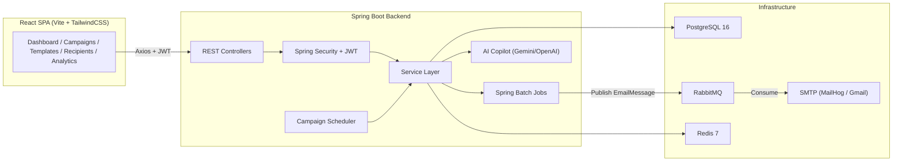

# MailFlow — Complete Project Analysis & Interview Guide

---

## 1. Project Overview

**MailFlow** is a **Scalable Email Campaign Automation Platform** — a full-stack application that enables users to create, manage, schedule, and send bulk email campaigns with recipient management, template personalisation, AI-assisted email drafting, and real-time analytics.

| Aspect | Details |
|---|---|
| **Architecture** | Monolithic Spring Boot backend + React SPA frontend |
| **Backend** | Java 21, Spring Boot 3.2.5 |
| **Frontend** | React 18, TypeScript, Vite, TailwindCSS |
| **Database** | PostgreSQL 16 with Flyway migrations |
| **Message Queue** | RabbitMQ 3.13 (AMQP) |
| **Cache/Rate Limiting** | Redis 7 |
| **Batch Processing** | Spring Batch |
| **Scheduling** | Spring Scheduler + Quartz |
| **AI Integration** | Google Gemini & OpenAI APIs |
| **Containerisation** | Docker (multi-stage) + Docker Compose |
| **API Docs** | Swagger / OpenAPI 3 (springdoc) |

---

## 2. Architecture Diagram



---

## 3. Backend Module-by-Module Analysis

### 3.1 Entry Point — [`MailFlowApplication.java`](file:///c:/Users/ssrij/Downloads/mailer/src/main/java/com/mailflow/MailFlowApplication.java)

| Annotation | Why |
|---|---|
| `@SpringBootApplication(exclude = FreeMarkerAutoConfiguration.class)` | Boots the app; excludes Spring's default FreeMarker auto-config because MailFlow configures FreeMarker manually for email template rendering (not MVC views) |
| `@ConfigurationPropertiesScan` | Picks up `MailFlowProperties` without listing it explicitly |
| `@EnableCaching` | Activates Redis-backed `@Cacheable`/`@CacheEvict` |
| `@EnableScheduling` | Enables the `@Scheduled` campaign launcher |
| `@EnableAsync` | Allows `@Async` methods (batch job launching) |

---

### 3.2 Security Module (`com.mailflow.security`)

#### [`SecurityConfig.java`](file:///c:/Users/ssrij/Downloads/mailer/src/main/java/com/mailflow/security/SecurityConfig.java)
- **Stateless JWT authentication** — no HTTP sessions (`SessionCreationPolicy.STATELESS`)
- **CSRF disabled** — not needed for stateless REST APIs
- **Role-based access control (RBAC)** with 3 roles: `ADMIN`, `CAMPAIGN_MANAGER`, `VIEWER`
- **Public endpoints**: `/api/auth/**`, `/api/unsubscribe/**`, `/swagger-ui/**`, `/actuator/health`
- **Method-level security**: `@EnableMethodSecurity` + `@PreAuthorize` annotations on controllers
- **Password encoding**: BCrypt with strength 12
- **Security headers**: `X-Frame-Options: DENY`, strict referrer policy, content-type-options
- **401 for unauthenticated**, **403 for unauthorised** (explicit `HttpStatusEntryPoint`)

#### [`JwtService.java`](file:///c:/Users/ssrij/Downloads/mailer/src/main/java/com/mailflow/security/JwtService.java)
- Signs tokens with **HMAC-SHA256** using a configurable secret
- Generates **access tokens** (1h default) and **refresh tokens** (7 days)
- Embeds user **roles** as a JWT claim
- Graceful Base64 decoding fallback for the secret key

#### [`JwtAuthFilter.java`](file:///c:/Users/ssrij/Downloads/mailer/src/main/java/com/mailflow/security/JwtAuthFilter.java)
- Extends `OncePerRequestFilter` — runs once per HTTP request
- Extracts `Bearer <token>` from the `Authorization` header
- On valid token, populates `SecurityContextHolder` with the authenticated user
- On invalid/missing token, request proceeds as anonymous (no exception thrown)

---

### 3.3 Auth Module (`com.mailflow.auth`)

#### [`AuthController.java`](file:///c:/Users/ssrij/Downloads/mailer/src/main/java/com/mailflow/auth/controller/AuthController.java)
Three public endpoints:
1. `POST /api/auth/register` — creates a new user with VIEWER role
2. `POST /api/auth/login` — authenticates and returns JWT pair
3. `POST /api/auth/refresh` — exchanges a refresh token for new tokens

#### [`AuthService.java`](file:///c:/Users/ssrij/Downloads/mailer/src/main/java/com/mailflow/auth/service/AuthService.java)
- **Registration**: checks for duplicate email, creates user with VIEWER role, returns JWT pair
- **Login**: delegates to Spring Security's `AuthenticationManager`, then issues tokens
- **Refresh**: validates the refresh token, issues a new access+refresh pair
- **ConflictException** for duplicate registration

#### [`User.java`](file:///c:/Users/ssrij/Downloads/mailer/src/main/java/com/mailflow/auth/entity/User.java)
- JPA entity implementing `UserDetails` directly (no adapter)
- `username` maps to `email` for Spring Security
- **Many-to-Many** relationship with `Role` (EAGER fetch for authorities)
- **Optimistic locking** (`@Version`) and **soft delete** (`deletedAt`)
- `isAccountNonLocked()` returns `false` when `deletedAt != null`

---

### 3.4 Campaign Module (`com.mailflow.campaign`)

This is the **core business module** — the most complex part of the system.

#### [`Campaign.java`](file:///c:/Users/ssrij/Downloads/mailer/src/main/java/com/mailflow/campaign/entity/Campaign.java)
- Central entity linking templates, recipients, and processing metrics
- **8-state lifecycle**: `DRAFT → SCHEDULED → QUEUED → RUNNING → COMPLETED` (with PAUSED, FAILED, CANCELLED branches)
- **`@DynamicUpdate`** — only changed columns are written to SQL (critical because send counters are incremented by bulk JPQL updates that bypass the entity)
- **`@Version`** — optimistic locking prevents concurrent status transitions from clobbering each other
- **Soft delete** (`deletedAt`, `deletedBy`) — keeps delivery history
- **`customBody`** — the campaign's own plain-text email body (V7), sent instead of the template's bodies when set
- **Computed helpers**: `successRate()`, `isRunnable()`, `isPauseable()`, `isCancellable()`, `isSending()`

#### [`CampaignService.java`](file:///c:/Users/ssrij/Downloads/mailer/src/main/java/com/mailflow/campaign/service/CampaignService.java) (~830 lines)
The most complex service — manages the entire campaign lifecycle:

- **CRUD**: create (DRAFT or SCHEDULED), update (DRAFT only), soft-delete with blocker checks
- **Launch validation**: requires email content + subject + sender + at least one recipient
- **Recipient resolution**: resolves saved contacts (by ID and group), campaign-only addresses, deduplicates by normalised email, filters unsubscribed/inactive/deleted
- **Idempotency**: each address gets at most one delivery row per campaign
- **`launchJobAfterCommit()`**: starts the batch job only after the DB transaction commits (`TransactionSynchronization`)
- **Delete blockers**: won't delete a campaign with running batch jobs or emails in the RabbitMQ queue (24h stale threshold)
- **Target address validation**: normalises emails, drops duplicates, validates format, limits to 10,000 per campaign
- **`@CacheEvict`** on all write operations

#### [`CampaignController.java`](file:///c:/Users/ssrij/Downloads/mailer/src/main/java/com/mailflow/campaign/controller/CampaignController.java)
REST endpoints with role-based security:
| Endpoint | Method | Access |
|---|---|---|
| `POST /api/campaigns` | Create | ADMIN, CAMPAIGN_MANAGER |
| `GET /api/campaigns` | List (paginated, filtered) | ADMIN, CAMPAIGN_MANAGER, VIEWER |
| `GET /api/campaigns/{id}` | Get details | ADMIN, CAMPAIGN_MANAGER, VIEWER |
| `PUT /api/campaigns/{id}` | Update (DRAFT only) | ADMIN, CAMPAIGN_MANAGER |
| `DELETE /api/campaigns/{id}` | Soft delete | ADMIN, CAMPAIGN_MANAGER |
| `POST /api/campaigns/{id}/launch` | Launch | ADMIN, CAMPAIGN_MANAGER |
| `POST /api/campaigns/{id}/pause` | Pause | ADMIN, CAMPAIGN_MANAGER |
| `POST /api/campaigns/{id}/resume` | Resume | ADMIN, CAMPAIGN_MANAGER |
| `POST /api/campaigns/{id}/cancel` | Cancel | ADMIN, CAMPAIGN_MANAGER |

---

### 3.5 Batch Processing Module (`com.mailflow.batch`)

This module implements the **high-throughput email sending pipeline** using Spring Batch.

#### [`CampaignBatchConfig.java`](file:///c:/Users/ssrij/Downloads/mailer/src/main/java/com/mailflow/batch/CampaignBatchConfig.java)
- Defines the **Reader → Processor → Writer** pipeline
- **Reader**: `JpaPagingItemReader` with a custom `getPage()` override that always returns 0 (because processed rows leave the result set)
- **Status-aware reader**: before each page, reads the campaign status; stops reading if the campaign is no longer RUNNING (pause/cancel/delete)
- **Fault tolerance**: `skipLimit=100`, retries for `MailException` and `ConnectException`, skips for `ValidationException`
- **Throttle limit**: configurable concurrent processing threads

> [!IMPORTANT]
> The reader's `getPage()` override is a critical design decision. Without it, the paging offset would advance while the result set simultaneously shrinks (as rows become QUEUED), causing the job to skip rows.

#### [`CampaignItemProcessor.java`](file:///c:/Users/ssrij/Downloads/mailer/src/main/java/com/mailflow/batch/CampaignItemProcessor.java)
- Validates each recipient (not already sent, has email, not unsubscribed)
- Builds the **personalisation model** from the recipient's fields
- Renders the email content using the **template engine** (FreeMarker)
- Returns `null` to skip (Spring Batch filters nulls)
- Re-reads campaign status before each item — stops processing on pause/cancel

#### [`CampaignItemWriter.java`](file:///c:/Users/ssrij/Downloads/mailer/src/main/java/com/mailflow/batch/CampaignItemWriter.java)
- Marks each record as QUEUED *before* publishing to RabbitMQ (prevents duplicates)
- Re-reads campaign status before each chunk
- Uses the `idempotencyKey` to prevent double-sending on overlapping runs

#### [`CampaignJobLauncher.java`](file:///c:/Users/ssrij/Downloads/mailer/src/main/java/com/mailflow/batch/CampaignJobLauncher.java)
- Launches batch jobs asynchronously with unique parameters
- Can find and stop running job executions (for cancel)

#### [`CampaignJobListener.java`](file:///c:/Users/ssrij/Downloads/mailer/src/main/java/com/mailflow/batch/CampaignJobListener.java)
- Sets campaign to RUNNING on start
- On completion: sets COMPLETED, PAUSED, CANCELLED, or FAILED based on current status

---

### 3.6 Message Queue Module (`com.mailflow.queue`)

#### [`EmailConsumer.java`](file:///c:/Users/ssrij/Downloads/mailer/src/main/java/com/mailflow/queue/EmailConsumer.java)
- `@RabbitListener` consuming from `email.queue`
- **Triple-guard before sending**:
  1. **Idempotency**: checks Redis for `email:sent:<key>` (48h TTL)
  2. **Campaign status**: paused → back to PENDING; cancelled/deleted → SKIPPED
  3. **Rate limiting**: token bucket via Redis Lua script
- On **send success**: writes Redis idempotency key, marks SENT, increments campaign counters, logs to `email_logs`
- On **permanent failure** (5xx SMTP): marks FAILED, does NOT rethrow (message is acked)
- On **temporary failure**: exception propagates to RabbitMQ retry interceptor (exponential backoff: 2s → 4s → 8s, max 3 attempts, then dead-letter queue)

#### [`RabbitMQConfig.java`](file:///c:/Users/ssrij/Downloads/mailer/src/main/java/com/mailflow/config/RabbitMQConfig.java)
```
email.exchange (direct)
  ├── email.queue          ← main processing queue (24h TTL)
  └── email.dead-letter.queue ← permanent failures
```
- Jackson JSON serialisation for messages
- Retry interceptor: 3 attempts, exponential backoff, then `RejectAndDontRequeueRecoverer` → dead-letter queue

---

### 3.7 Email Module (`com.mailflow.email`)

#### [`SmtpEmailProvider.java`](file:///c:/Users/ssrij/Downloads/mailer/src/main/java/com/mailflow/email/SmtpEmailProvider.java)
- Sends via Spring's `JavaMailSender` (MIME multipart: HTML + plain text)
- **Gmail compatibility**: authenticated SMTP forces the From address to the authenticated account; the campaign's sender becomes Reply-To
- **Failure classification**: 5xx → `PermanentEmailException`; everything else is retryable

#### [`DevEmailProvider.java`](file:///c:/Users/ssrij/Downloads/mailer/src/main/java/com/mailflow/email/DevEmailProvider.java)
- No-op provider for development mode — logs instead of sending

#### [`RateLimiterService.java`](file:///c:/Users/ssrij/Downloads/mailer/src/main/java/com/mailflow/email/RateLimiterService.java)
- **Token-bucket rate limiter** backed by Redis
- Atomic Lua script: `INCR + EXPIRE` in one Redis call → no race conditions
- Per-campaign, per-minute window (default: 100 emails/minute)
- **Fails open**: if Redis is unavailable, allows sending (doesn't block campaigns)

#### [`UnsubscribeService.java`](file:///c:/Users/ssrij/Downloads/mailer/src/main/java/com/mailflow/email/UnsubscribeService.java) / [`UnsubscribeController.java`](file:///c:/Users/ssrij/Downloads/mailer/src/main/java/com/mailflow/email/controller/UnsubscribeController.java)
- One-click unsubscribe via tokenised URL
- Tokens are SHA-256 hashes of email + secret + timestamp
- Public GET endpoint (no JWT needed)

---

### 3.8 Template Module (`com.mailflow.template`)

#### [`TemplateEngineService.java`](file:///c:/Users/ssrij/Downloads/mailer/src/main/java/com/mailflow/template/service/TemplateEngineService.java)
- Converts **Mustache-like syntax** (`{{variableName}}`) → FreeMarker (`${(variableName)!}`) internally
- Uses `!` suffix so missing variables render as empty strings instead of throwing
- **Fallback renderer**: simple string replacement if FreeMarker fails
- Thread-safe via unique per-render template keys in `StringTemplateLoader`

#### [`TemplateService.java`](file:///c:/Users/ssrij/Downloads/mailer/src/main/java/com/mailflow/template/service/TemplateService.java)
- CRUD for email templates with Redis caching
- **Preview**: renders a template with sample data for the UI
- **Variable extraction**: scans subject + htmlBody + plainBody for `{{var}}` patterns
- Soft-delete (sets `deletedAt`)

#### [`CampaignEmailContent.java`](file:///c:/Users/ssrij/Downloads/mailer/src/main/java/com/mailflow/template/service/CampaignEmailContent.java)
- Resolves what email content to send: campaign's own body vs. template's bodies
- When the campaign has a `customBody`, it is sent as text/plain + auto-generated HTML

---

### 3.9 Recipient Module (`com.mailflow.recipient`)

#### [`RecipientService.java`](file:///c:/Users/ssrij/Downloads/mailer/src/main/java/com/mailflow/recipient/service/RecipientService.java)
- CRUD for contacts with email normalisation and validation
- **Duplicate detection**: case-insensitive email check on active (non-deleted) contacts
- **Lookup endpoint**: finds contacts by ID and/or email, reports deleted/unsubscribed ones
- Soft-delete, Redis caching

#### [`RecipientImportService.java`](file:///c:/Users/ssrij/Downloads/mailer/src/main/java/com/mailflow/recipient/service/RecipientImportService.java)
- Bulk import from **CSV** (OpenCSV) and **Excel** (Apache POI)
- Preview before importing
- Deduplication during import

#### [`RecipientGroupService.java`](file:///c:/Users/ssrij/Downloads/mailer/src/main/java/com/mailflow/recipient/service/RecipientGroupService.java)
- Group management for organising recipients
- Groups can be targeted by campaigns

---

### 3.10 Analytics Module (`com.mailflow.analytics`)

#### [`AnalyticsService.java`](file:///c:/Users/ssrij/Downloads/mailer/src/main/java/com/mailflow/analytics/AnalyticsService.java)
- **Per-campaign analytics**: total, sent, failed, skipped, bounced, retried, success rate, throughput (emails/minute), duration
- **Dashboard summary**: aggregate totals across all non-deleted campaigns
- **Daily volume**: time-series email volume over last N days

#### [`EmailLogService.java`](file:///c:/Users/ssrij/Downloads/mailer/src/main/java/com/mailflow/analytics/EmailLogService.java)
- Writes detailed per-message audit trail to `email_logs` table
- Captures: status, error message, error type, attempt number, provider message ID

---

### 3.11 AI Module (`com.mailflow.ai`)

#### [`AiConfig.java`](file:///c:/Users/ssrij/Downloads/mailer/src/main/java/com/mailflow/ai/AiConfig.java)
- **Strategy Pattern**: selects the active AI provider based on configuration
  - `gemini` → `GeminiContentProvider`
  - `openai` → `OpenAiContentProvider`
  - disabled/missing key → `NoOpAiContentProvider` (returns a clear error)

#### [`GeminiContentProvider.java`](file:///c:/Users/ssrij/Downloads/mailer/src/main/java/com/mailflow/ai/GeminiContentProvider.java)
- Calls Google Gemini's `generateContent` endpoint via `WebClient`
- Requests `responseMimeType: application/json` for structured output
- Handles rate limiting (429), auth errors (400/401/403), and timeouts gracefully
- **API key never logged** — security best practice

#### AI Features:
1. **Generate**: drafts a professional email from a free-form prompt
2. **Improve**: rewrites an existing subject+body, preserving tone/length/intent

---

### 3.12 Configuration Module (`com.mailflow.config`)

| Class | Purpose |
|---|---|
| [`MailFlowProperties.java`](file:///c:/Users/ssrij/Downloads/mailer/src/main/java/com/mailflow/config/MailFlowProperties.java) | Type-safe `@ConfigurationProperties` for all `mailflow.*` config (JWT, email, batch, storage, AI, unsubscribe) |
| [`RedisConfig.java`](file:///c:/Users/ssrij/Downloads/mailer/src/main/java/com/mailflow/config/RedisConfig.java) | `RedisTemplate` + `CacheManager` with per-cache TTLs and Jackson serialisation with `JavaTimeModule` |
| [`RabbitMQConfig.java`](file:///c:/Users/ssrij/Downloads/mailer/src/main/java/com/mailflow/config/RabbitMQConfig.java) | Exchange + queue topology, dead-letter setup, retry interceptor |
| [`FreemarkerConfig.java`](file:///c:/Users/ssrij/Downloads/mailer/src/main/java/com/mailflow/config/FreemarkerConfig.java) | Manual FreeMarker configuration (StringTemplateLoader, not file-based) |
| [`WebConfig.java`](file:///c:/Users/ssrij/Downloads/mailer/src/main/java/com/mailflow/config/WebConfig.java) | CORS configuration for frontend |
| [`OpenApiConfig.java`](file:///c:/Users/ssrij/Downloads/mailer/src/main/java/com/mailflow/config/OpenApiConfig.java) | Swagger/OpenAPI metadata and security scheme |

---

### 3.13 Common Module (`com.mailflow.common`)

| Class | Purpose |
|---|---|
| `GlobalExceptionHandler` | `@RestControllerAdvice` — maps exceptions to HTTP responses (400/404/409/500) |
| `ApiError` | Standard error response DTO |
| `PageResponse<T>` | Generic paginated response wrapper |
| `ResourceNotFoundException` | 404 |
| `ConflictException` | 409 (duplicate, status conflict) |
| `ValidationException` | 400 |
| `MailFlowException` | Generic with custom HTTP status and error code |
| `EmailValidator` | Email normalisation (trim, lowercase, invisible characters) and validation |
| `EmailContentRules` | Subject/body length and character validation |

---

### 3.14 Scheduler Module (`com.mailflow.scheduler`)

#### [`CampaignScheduler.java`](file:///c:/Users/ssrij/Downloads/mailer/src/main/java/com/mailflow/scheduler/CampaignScheduler.java)
- `@Scheduled` method runs every minute
- Finds SCHEDULED campaigns whose `scheduledAt` has passed
- Launches them automatically (excluded deleted campaigns)

---

## 4. Database Schema & Migrations

7 Flyway migrations:

| Migration | Purpose |
|---|---|
| **V1** | Full initial schema: users, roles, recipients, groups, templates, campaigns, campaign_recipients, email_logs, email_events, unsubscribe_list, attachments, scheduled_campaigns + all indexes |
| **V2** | Spring Batch metadata tables |
| **V3** | Seed data (initial roles: ADMIN, CAMPAIGN_MANAGER, VIEWER; admin user) |
| **V4** | Campaign target groups + target recipients join tables (`@ElementCollection`) |
| **V5** | Campaign-only addresses table (`campaign_target_addresses`) + snapshot columns on `campaign_recipients` |
| **V6** | Campaign soft delete (`deleted_at`, `deleted_by` columns) |
| **V7** | Campaign custom body (`custom_body` column) |

---

## 5. Frontend Analysis

### 5.1 Technology Stack

| Technology | Version | Purpose |
|---|---|---|
| React | 18.3 | UI library |
| TypeScript | 5.5 | Type safety |
| Vite | 5.3 | Build tool / dev server |
| TailwindCSS | 3.4 | Utility-first CSS framework |
| React Router | 6.24 | Client-side routing |
| Zustand | 4.5 | Lightweight state management (auth) |
| TanStack React Query | 5.48 | Server state management, caching |
| Axios | 1.7 | HTTP client |
| Recharts | 2.12 | Charts for analytics |
| Lucide React | 0.396 | Icons |
| React Hot Toast | 2.4 | Notifications |
| date-fns | 3.6 | Date formatting |

### 5.2 Frontend Architecture

```
frontend/src/
├── api/           # API layer (Axios calls)
│   ├── client.ts  # Axios instance with JWT interceptor
│   ├── campaigns.ts
│   ├── recipients.ts
│   ├── templates.ts
│   └── ai.ts
├── components/    # Reusable UI components
│   ├── ui/        # Design system (Button, Card, Modal, etc.)
│   ├── CampaignFormModal.tsx
│   ├── CampaignContentSection.tsx
│   ├── CampaignRecipientSelector.tsx
│   ├── TemplateEditorModal.tsx
│   ├── TemplatePreviewPanel.tsx
│   ├── AiImproveModal.tsx
│   ├── RecipientExcelUpload.tsx
│   └── ...
├── pages/         # Route-level pages
│   ├── LoginPage.tsx
│   ├── DashboardPage.tsx
│   ├── CampaignsPage.tsx
│   ├── CampaignDetailPage.tsx
│   ├── RecipientsPage.tsx
│   ├── TemplatesPage.tsx
│   └── AnalyticsPage.tsx
├── store/         # Zustand auth store
├── lib/           # Business logic utilities
├── types/         # TypeScript interfaces
└── utils/         # Helpers
```

### 5.3 Key Frontend Patterns

1. **Auth**: JWT stored in `localStorage`, auto-attached to every request via Axios interceptor, 401 → redirect to login
2. **State**: Zustand for auth, React Query for server state (campaigns, templates, recipients)
3. **Routing**: `PrivateRoute` HOC checks `isAuthenticated`; Layout wraps authenticated pages
4. **Role-based UI**: roles decoded from JWT payload to show/hide action buttons
5. **API client**: centralised Axios instance with Base URL from `VITE_API_URL`

---

## 6. DevOps & Infrastructure

### Docker Multi-Stage Build ([`Dockerfile`](file:///c:/Users/ssrij/Downloads/mailer/Dockerfile))
- **Stage 1**: Maven build on `maven:3.9.6-eclipse-temurin-21-alpine` — dependency caching, skip tests
- **Stage 2**: Runtime on `eclipse-temurin:21-jre-alpine` — non-root user, 75% RAM allocation

### Docker Compose ([`docker-compose.yml`](file:///c:/Users/ssrij/Downloads/mailer/docker-compose.yml))
6 services with health checks and dependency ordering:
1. **PostgreSQL 16** (with persistent volume)
2. **Redis 7** (with persistent volume)
3. **RabbitMQ 3.13** (with management UI on :15672)
4. **MailHog** (fake SMTP on :1025, web UI on :8025)
5. **Backend** (depends on postgres, redis, rabbitmq being healthy)
6. **Frontend** (depends on backend)

---

## 7. Testing

**28 test files** covering:
- **Service layer tests**: CampaignServiceTest, RecipientServiceTest, AuthServiceTest, TemplateEngineServiceTest
- **Batch pipeline tests**: CampaignOnlyAddressPipelineTest, CampaignPauseResumeTest, CampaignItemProcessorModelTest
- **Integration tests**: SmtpEmailProviderTest, SmtpConfigValidatorTest, RateLimiterServiceTest
- **Security tests**: CampaignDeleteSecurityTest, SeedCredentialsTest
- **Utility tests**: EmailValidatorTest
- **Frontend tests**: campaignChecks.test.ts, campaignContent.test.ts, manualTable.test.ts
- **Test infrastructure**: H2 for unit tests, Testcontainers (PostgreSQL, RabbitMQ) for integration tests

---

## 8. Key Design Patterns Used

| Pattern | Where | Why |
|---|---|---|
| **Strategy** | `AiContentProvider` (Gemini / OpenAI / NoOp) | Swap AI providers without changing consuming code |
| **Strategy** | `EmailProvider` (SMTP / Dev) | Swap email delivery backends |
| **Template Method** | Spring Batch (Reader → Processor → Writer) | Standard batch processing pipeline |
| **Observer** | `TransactionSynchronization` (afterCommit hooks) | Launch batch jobs only after DB commit |
| **Repository** | Spring Data JPA repositories | Abstract database access |
| **DTO** | Request/Response records throughout | Separate API contracts from entities |
| **Builder** | Lombok `@Builder` on entities and messages | Clean object construction |
| **Factory** | `AiConfig`, `EmailProviderConfig` | Create the right implementation based on config |
| **Optimistic Locking** | `@Version` on User, Campaign, Recipient | Prevent concurrent modification conflicts |
| **Soft Delete** | `deletedAt` on campaigns, recipients, templates | Preserve data integrity and audit trail |
| **Idempotency** | Redis keys + DB unique constraints | Prevent duplicate email delivery |
| **Token Bucket** | Redis Lua script rate limiter | Per-campaign rate limiting |
| **Dead Letter Queue** | RabbitMQ DLX | Capture permanently failed messages |

---

# 50 Interview Questions & Answers

---

### **Architecture & Design**

---

**Q1. What is the overall architecture of MailFlow, and why was a monolithic approach chosen over microservices?**

**A:** MailFlow uses a **monolithic Spring Boot backend** with a **React SPA frontend**. The monolithic approach was chosen because:
- The team size and project scope don't justify the operational overhead of microservices (service discovery, distributed transactions, API gateways)
- The domain modules (campaign, recipient, template, email, batch) are logically separated into packages, making it easy to refactor into microservices later if needed
- A single deployment unit simplifies development, testing, and debugging
- However, the architecture already uses **message-driven communication** (RabbitMQ) between the batch pipeline and the email consumer, which is a microservice-ready pattern

---

**Q2. Explain the complete email-sending pipeline from campaign launch to email delivery.**

**A:** 
1. **Launch**: `CampaignService.launch()` validates the campaign, resolves recipients (saved contacts + campaign-only addresses), creates `CampaignRecipient` delivery rows with PENDING status, sets campaign to QUEUED
2. **After commit**: A `TransactionSynchronization.afterCommit()` callback starts the Spring Batch job
3. **Batch Reader**: `JpaPagingItemReader` reads PENDING/FAILED delivery rows from the database in pages
4. **Batch Processor**: Validates each recipient (not unsubscribed, has email), renders the personalised email content using FreeMarker
5. **Batch Writer**: Marks each row as QUEUED, publishes an `EmailMessage` to RabbitMQ's `email.queue`
6. **Email Consumer**: RabbitMQ consumer picks up the message, checks idempotency (Redis), checks campaign status (pause/cancel), checks rate limit (Redis Lua script), then sends via SMTP
7. **On success**: Redis idempotency key set, delivery row → SENT, campaign counters incremented, `email_logs` entry written
8. **On permanent failure**: Row → FAILED, campaign failure counter incremented
9. **On temporary failure**: Exception propagates to RabbitMQ retry interceptor (exponential backoff), after 3 attempts → dead-letter queue

---

**Q3. Why was Spring Batch chosen for processing campaigns instead of a simple loop?**

**A:** Spring Batch provides:
- **Chunk-oriented processing**: reads, processes, and writes in configurable chunks (default 50), reducing memory usage and enabling transactional boundaries per chunk
- **Fault tolerance**: built-in skip, retry, and no-rollback policies — a single bad email doesn't crash the entire campaign
- **Restartability**: failed jobs can be restarted from where they left off
- **Scalability**: throttle limit controls concurrent processing threads
- **Monitoring**: Spring Batch metadata tables track job executions, step status, and read/write/skip counts
- **Lifecycle management**: `JobListener` handles status transitions, `JobOperator` can stop running jobs

---

**Q4. Explain the idempotency strategy and why it has multiple layers.**

**A:** MailFlow prevents duplicate email delivery through **three complementary layers**:
1. **Database unique constraint**: `campaign_recipients.idempotency_key` is unique — prevents duplicate delivery rows
2. **Batch Writer claim**: the writer marks a row as QUEUED before publishing; if another run already did, the `markQueued()` update returns 0 affected rows and the message is not published again
3. **Redis idempotency key**: the consumer checks `email:sent:<key>` in Redis (48h TTL) before sending; duplicate RabbitMQ deliveries (e.g., broker restart) are suppressed

Multiple layers are needed because:
- The database layer prevents duplicate *rows* (e.g., two concurrent launches)
- The batch writer layer prevents duplicate *messages* (e.g., overlapping pause+resume)
- The Redis layer prevents duplicate *sends* (e.g., RabbitMQ redelivery after consumer crash)

---

**Q5. How does the system handle campaign pause and resume?**

**A:** **Pause**:
1. `CampaignService.pause()` sets campaign status to PAUSED in the database
2. The **batch reader** re-reads the status before each page — finds PAUSED, returns an empty page, and the step ends
3. The **batch processor** re-reads the status before each item — items already read but not yet processed return null (filtered by Spring Batch)
4. The **batch writer** re-reads the status before each chunk — does nothing if not RUNNING
5. The **RabbitMQ consumer** checks the status before sending — for a PAUSED campaign, it returns the delivery row to PENDING status (using `SELECT FOR UPDATE` to handle race conditions with a concurrent resume)
6. The **job listener** sees the campaign is PAUSED and keeps PAUSED status (instead of setting COMPLETED)

**Resume**:
1. `CampaignService.resume()` sets status to QUEUED, starts a new batch job after commit
2. The new job's reader reads only PENDING and FAILED rows — already-SENT rows are not re-read
3. Rows returned to PENDING during the pause are picked up again

---

### **Spring Boot & Backend**

---

**Q6. Why does the application exclude `FreeMarkerAutoConfiguration`?**

**A:** Spring Boot's auto-configuration would set up FreeMarker for **MVC view rendering** (looking for `.ftlh` files in `/templates/`). MailFlow uses FreeMarker purely for **email template variable substitution** via a `StringTemplateLoader` (in-memory strings, not files). The manual configuration in `FreemarkerConfig.java` creates a `Configuration` bean with the appropriate settings. Without the exclusion, Spring would try to configure FreeMarker twice with conflicting settings.

---

**Q7. Explain the `@DynamicUpdate` annotation on the Campaign entity and why it's critical.**

**A:** `@DynamicUpdate` tells Hibernate to generate SQL UPDATE statements that include only the columns that actually changed, rather than updating all columns.

This is critical because the `EmailConsumer` increments campaign counters (`sentCount`, `failedCount`, etc.) via **bulk JPQL updates** (`campaignRepository.incrementCounters()`) that don't load or change the `version` column. If a lifecycle action (pause, resume, cancel) saved the full Campaign entity with `@DynamicUpdate` off, it would write back the counter values as they were when the entity was loaded — losing all the increments made by the email consumer in the meantime. With `@DynamicUpdate`, the lifecycle save only writes the status and other fields it actually changed, leaving the counters untouched.

---

**Q8. Why are batch jobs launched after the transaction commits, not inside it?**

**A:** The `launchJobAfterCommit()` method uses `TransactionSynchronizationManager.registerSynchronization()` to start the batch job only after the surrounding database transaction commits. This ensures:
1. The batch job always sees the committed data (QUEUED status, delivery rows)
2. If the transaction rolls back (e.g., optimistic lock failure from concurrent launches), no job starts — avoiding an orphan job processing a rollback-state campaign
3. Race condition prevention: two users clicking "Launch" simultaneously → the second loses the optimistic lock, its transaction rolls back, and no second job starts

---

**Q9. How does the project handle configuration and secrets?**

**A:** 
- **`MailFlowProperties`**: a `@ConfigurationProperties` class with nested static classes for type-safe access to all `mailflow.*` properties
- **Environment variables**: all sensitive values (`DB_PASSWORD`, `JWT_SECRET`, `SMTP_PASSWORD`, `GEMINI_API_KEY`) are resolved from environment variables via `${ENV_VAR:default}` syntax in `application.yml`
- **`.env.example`**: documents all required environment variables with safe defaults for development
- **No secrets in source code**: all defaults are development-safe (localhost, guest passwords)
- **Docker Compose**: passes environment variables to each container
- **Validation**: `@NotBlank`, `@NotNull`, `@Min` on properties ensure misconfiguration fails fast at startup

---

**Q10. Explain the role-based access control (RBAC) implementation.**

**A:** Three roles with hierarchical access:

| Role | Can do |
|---|---|
| **ADMIN** | Everything + admin endpoints |
| **CAMPAIGN_MANAGER** | Create/edit/delete campaigns, templates, recipients; launch/pause/resume/cancel |
| **VIEWER** | Read-only access to campaigns, templates, recipients, analytics |

Implementation:
1. **Database**: `roles` table with a `user_roles` join table (many-to-many)
2. **JWT**: roles are stored as claims (e.g., `["ROLE_CAMPAIGN_MANAGER"]`)
3. **SecurityConfig**: route-level access rules via `authorizeHttpRequests()`
4. **Method security**: `@PreAuthorize("hasAnyRole('ADMIN','CAMPAIGN_MANAGER')")` on controller methods
5. **Frontend**: JWT payload is decoded to extract roles; UI conditionally shows action buttons (the server always re-validates on each request)

---

### **Database & JPA**

---

**Q11. Why was Flyway chosen over Hibernate DDL auto-generation?**

**A:** Flyway provides:
- **Versioned, repeatable migrations** with a clear audit trail
- **Data seeding** (V3 seeds roles and admin user)
- **Complex schema changes** like adding constraints, indexes, and Spring Batch tables that Hibernate can't auto-generate
- **Production safety**: `ddl-auto: validate` ensures the schema matches the entities without Hibernate ever modifying the database
- **Team collaboration**: SQL migrations are easier to code review than Hibernate's generated DDL

---

**Q12. Explain the optimistic locking strategy and where it's used.**

**A:** Optimistic locking uses a `@Version` column that's automatically incremented by Hibernate on every update. If two transactions read the same row, modify it, and try to save, the second save sees a version mismatch and throws `OptimisticLockException` (mapped to 409 Conflict).

Used on:
- **Campaign**: prevents concurrent status transitions (e.g., two users launching simultaneously, or a launch racing with a delete)
- **User**: prevents concurrent account updates
- **Recipient**: prevents concurrent edits

---

**Q13. Explain the soft-delete pattern used in the project.**

**A:** Instead of `DELETE FROM` SQL, entities have a `deletedAt` timestamp column:
- **`null`**: live entity
- **Non-null**: deleted — treated as non-existent by all queries

Implemented on: Campaign, Recipient, EmailTemplate, User

Benefits:
- **Audit trail**: can see when entities were deleted and by whom (Campaign has `deletedBy`)
- **Data integrity**: foreign keys referencing deleted entities don't break
- **Recovery**: possible to undelete by setting `deletedAt` back to null
- **Analytics**: deleted campaigns' email logs and delivery history are preserved

Queries filter with `WHERE deleted_at IS NULL` (repository methods like `findByDeletedAtIsNull()`).

---

**Q14. Why does the `campaign_recipients` table use an `idempotency_key` instead of a simple composite unique constraint?**

**A:** The `idempotency_key` (format: `campaign_{id}_recipient_{id}` or `campaign_{id}_address_{email}`) serves multiple purposes:
1. **Cross-layer idempotency**: the same key is used in the database, in the RabbitMQ message, and in the Redis dedup check — a single identifier that tracks a delivery across all systems
2. **Campaign-only addresses**: these have no `recipient_id`, so a composite `(campaign_id, recipient_id)` constraint wouldn't work. The key format `campaign_{id}_address_{email}` handles this case
3. **RabbitMQ message identification**: the consumer uses the key to update the database row without needing to query by multiple fields
4. **Redis dedup**: a single string key for fast lookup

---

### **Messaging & Redis**

---

**Q15. Explain the RabbitMQ dead-letter queue pattern and when messages end up there.**

**A:** The `email.queue` is configured with:
- `x-dead-letter-exchange: email.dead-letter.exchange`
- `x-dead-letter-routing-key: email.dead`
- `x-message-ttl: 86400000` (24 hours)

Messages go to the dead-letter queue when:
1. **Retry exhaustion**: after 3 consumer retry attempts (2s → 4s → 8s), the `RejectAndDontRequeueRecoverer` rejects the message with `requeue=false` → RabbitMQ routes it to the DLX
2. **TTL expiry**: a message sitting in the queue for more than 24 hours (e.g., consumer offline) expires and is dead-lettered
3. **Queue length limit** (not configured, but supported)

The dead-letter queue enables:
- Manual inspection of failed messages
- Alerting on delivery failures
- Potential retry from the dead-letter queue

---

**Q16. Why is a Lua script used for the rate limiter instead of simple Redis commands?**

**A:** The rate limiter needs to `INCR` a counter and `EXPIRE` it atomically:
```lua
local current = redis.call('INCR', KEYS[1])
if current == 1 then
    redis.call('EXPIRE', KEYS[1], 60)
end
return current
```

Without a Lua script, two separate commands (`INCR` then `EXPIRE`) create a race condition:
- Thread A: `INCR` → counter = 1
- Thread B: `INCR` → counter = 2
- Thread A: `EXPIRE` → sets 60s TTL
- Thread B: `EXPIRE` → resets TTL to 60s (losing the time already elapsed)

The Lua script runs atomically on Redis's single-threaded event loop, ensuring `EXPIRE` is only called when `current == 1` (first increment in the window).

---

**Q17. Why does the rate limiter "fail open" when Redis is unavailable?**

**A:** If the rate limiter threw an exception when Redis was down, all email sending would stop — creating an outage for a non-critical feature. By returning `true` (allow), campaigns continue sending at full speed without rate limiting. The trade-off is acceptable because:
- SMTP servers have their own rate limits
- Redis downtime is typically brief
- It's better to send slightly faster than intended than to halt all campaigns

---

### **Email & Templates**

---

**Q18. How does MailFlow handle the Gmail "From address" restriction?**

**A:** Gmail rejects (or silently rewrites) emails where the `From` header doesn't match the authenticated SMTP account. `SmtpEmailProvider` handles this by:
1. When `authenticatedUsername` is set (SMTP_AUTH=true): the `From` address is forced to the authenticated account (e.g., `noreply@gmail.com`)
2. The campaign's intended sender email is moved to the `Reply-To` header
3. The campaign's sender name is kept in the `From` display name
4. If the user explicitly set a `replyTo`, that takes precedence

For MailHog (development mode), `authenticatedUsername` is blank, so the campaign's sender email is used as-is.

---

**Q19. Why does MailFlow use FreeMarker internally but expose `{{variable}}` syntax to users?**

**A:** 
- **User-facing**: `{{variable}}` (Mustache-like) is simple, familiar, and non-technical. Users don't need to learn FreeMarker syntax
- **Internal**: the `TemplateEngineService` converts `{{var}}` to `${(var)!}` — the `!` suffix means missing/null variables render as empty strings instead of throwing `TemplateException`
- **Fallback**: if FreeMarker fails (e.g., invalid template syntax), a simple string-replace fallback ensures partial rendering rather than a crash
- **Separation**: users never see or need to understand FreeMarker directives like `<#if>`, `<#list>`, etc.

---

**Q20. How does the template preview work, and why is it important that it uses the same rendering path as real sends?**

**A:** The preview renders the template with sample recipient data through the same `CampaignEmailContent.render()` → `TemplateEngineService.render()` path as the actual batch processor. This ensures:
1. **WYSIWYG**: the preview shows exactly what the recipient will receive
2. **Missing variable detection**: the preview reports which placeholders resolve to empty strings
3. **Custom body handling**: when a campaign has a `customBody`, the preview renders it the same way the processor does (as text/plain + auto-generated HTML)
4. **No surprises**: if a template works in preview, it works in a real send

---

### **Frontend**

---

**Q21. Why was Zustand chosen for state management instead of Redux or Context API?**

**A:** Zustand was chosen because:
- **Minimal boilerplate**: no action types, reducers, or providers — just a function
- **Only auth needs global state**: campaigns, templates, and recipients are managed by React Query (server state ≠ client state)
- **Performance**: Zustand uses subscriptions, so components re-render only when the specific slice they read changes
- **Small bundle size**: ~1KB vs. Redux's ~7KB
- Context API would cause unnecessary re-renders of the entire component tree

---

**Q22. How does the frontend handle authentication and token expiry?**

**A:** 
1. **Login**: `authStore.login()` calls `/api/auth/login`, stores the JWT in `localStorage`, sets `isAuthenticated=true`
2. **Request attachment**: Axios request interceptor reads the token from `localStorage` and adds `Authorization: Bearer <token>` to every request
3. **401 handling**: Axios response interceptor catches 401 responses, clears the token, and redirects to `/login`
4. **Page reload**: `initFromStorage()` reads the token, decodes the JWT payload (base64), checks `exp` against `Date.now()`, and restores `isAuthenticated` and `roles` if valid
5. **Expired token**: if `exp * 1000 < Date.now()`, the token is removed and the user must re-login
6. **Route protection**: `PrivateRoute` component checks `isAuthenticated` and redirects to `/login` if false

---

**Q23. How does the frontend implement role-based UI visibility?**

**A:** Roles are decoded from the JWT payload (`ROLE_CAMPAIGN_MANAGER` → `CAMPAIGN_MANAGER`) and stored in `authStore.roles[]`. Components conditionally render action buttons:
```tsx
const roles = useAuthStore((s) => s.roles);
const canEdit = roles.includes('ADMIN') || roles.includes('CAMPAIGN_MANAGER');
```
This is a **UI convenience only** — the backend always validates roles on every request via Spring Security. If a VIEWER somehow triggers a write endpoint, the backend returns 403.

---

### **Testing**

---

**Q24. What testing strategy does the project use?**

**A:** Multi-level testing with 28+ test files:
1. **Unit tests** (H2 in-memory database): service layer logic, validators, utility classes
2. **Integration tests** (Testcontainers): PostgreSQL + RabbitMQ containers for testing real infrastructure behaviour
3. **Security tests**: verify role-based access control
4. **Frontend tests** (Vitest): business logic utilities (campaignChecks, campaignContent, manualTable)

Key test patterns:
- **Mocking**: Spring's `@MockBean` for isolating service dependencies
- **Testcontainers**: real PostgreSQL and RabbitMQ for integration tests
- **Security testing**: verify protected endpoints reject unauthenticated/unauthorised requests

---

**Q25. Why does the project use both H2 and Testcontainers for testing?**

**A:** 
- **H2**: for fast unit tests that only need a SQL database — starts instantly, no Docker needed. Used for service tests that don't depend on PostgreSQL-specific features
- **Testcontainers**: for integration tests that need PostgreSQL-specific behaviour (e.g., `JSONB` columns, `pgcrypto` extension, Flyway migrations). Also used for RabbitMQ integration tests
- The separation keeps the test suite fast (unit tests run in seconds) while still verifying real infrastructure behaviour where it matters

---

### **DevOps & Deployment**

---

**Q26. Explain the Docker multi-stage build and why it's used.**

**A:** Two stages:
1. **Builder** (`maven:3.9.6-eclipse-temurin-21-alpine`): copies `pom.xml` first for dependency caching, then copies source and builds — tests skipped (run in CI)
2. **Runtime** (`eclipse-temurin:21-jre-alpine`): copies only the JAR, runs as a non-root user (`mailflow:mailflow`)

Benefits:
- **Smaller image**: runtime image has no Maven, no source code, no build artifacts (~180MB vs ~800MB)
- **Security**: non-root user, no build tools in production
- **Caching**: Docker layer caching means dependency changes rebuild from `pom.xml` layer, source changes only rebuild the source layer
- **JVM tuning**: `MaxRAMPercentage=75%` and `UseContainerSupport` for container-aware memory management

---

**Q27. How does the Docker Compose setup handle service dependencies?**

**A:** `depends_on` with `condition: service_healthy`:
- Backend waits for PostgreSQL (`pg_isready`), Redis (`redis-cli ping`), and RabbitMQ (`rabbitmq-diagnostics ping`) to be healthy
- Frontend waits for the backend to start
- This prevents the backend from starting before its infrastructure is ready, avoiding connection failures on startup

---

### **Specific Code Deep-Dives**

---

**Q28. Why does the batch reader always return page 0?**

**A:** The reader's JPQL query selects PENDING/FAILED rows. The writer flips processed rows to QUEUED. With a normal paging reader (page 0, then page 1, then page 2...), the result set shrinks after each page as rows become QUEUED. Page 1 would skip past still-unprocessed rows because the offset advances while the matching set shrinks. By overriding `getPage()` to always return 0, the reader always reads the first page of remaining unprocessed rows — which is always the next batch to process.

---

**Q29. How does campaign deletion handle in-flight messages?**

**A:** Campaign deletion uses multiple safeguards:
1. **Status check**: QUEUED and RUNNING campaigns always get 409 — user must cancel first
2. **Batch job check**: if a `JobExecution` is still running for this campaign, deletion is blocked (with a 24h staleness threshold for stuck jobs)
3. **Queue check**: counts delivery rows that are QUEUED and less than 24 hours old — if any, deletion is blocked (with the stale time communicated to the user)
4. **Optimistic lock**: the campaign row is locked with `FOR UPDATE` and the save increments `version` — a concurrent launch or resume that loaded the campaign before the delete commit will fail its version check
5. **Post-delete**: the consumer checks status before sending — a deleted campaign's messages are SKIPPED

---

**Q30. Explain the `PersonalizationModel` and how it handles campaign-only addresses.**

**A:** `PersonalizationModel.forRecipient()` builds a `Map<String, Object>` from a `Recipient`'s fields:
- Standard fields: `email`, `name`, `firstName`, `lastName`, `company`, `course`
- Custom fields: any key-value pairs from `customFields` map (e.g., `Team`, `Department`)

For **campaign-only addresses** (no saved contact), the batch processor creates a transient `Recipient` from the delivery row's snapshot fields (`snapshotEmail`, `snapshotName`, etc.) so the same `PersonalizationModel` code works for both cases. This ensures template rendering is identical whether the address belongs to a saved contact or is a one-time campaign address.

---

**Q31. How does the AI copilot integrate with the email workflow?**

**A:** The AI copilot is **optional** and **isolated**:
1. **Configuration**: enabled/disabled via `AI_ENABLED` env var; provider selection via `AI_PROVIDER`
2. **Strategy Pattern**: `AiConfig` creates the right `AiContentProvider` bean:
   - `GeminiContentProvider` → Google's Generative Language API
   - `OpenAiContentProvider` → OpenAI's Chat Completions API
   - `NoOpAiContentProvider` → returns "AI not configured" error
3. **Usage**: the frontend's "Improve with AI" button sends the current subject+body to `POST /api/ai/improve`
4. **Response**: the AI returns an improved subject+body; the user decides whether to accept
5. **Safety**: API keys are never logged, timeouts are bounded, rate-limit errors are handled gracefully

---

**Q32. What happens when you register a new user?**

**A:** 
1. `POST /api/auth/register` with `{email, password, firstName, lastName}`
2. `AuthService.register()`:
   - Checks if email is already registered (case-insensitive) → 409 if duplicate
   - Finds or creates the VIEWER role
   - Creates a `User` entity with BCrypt-hashed password (strength 12)
   - Saves the user
   - Generates access + refresh JWT tokens
3. Returns `AuthResponse` with tokens and user info (id, email, name, roles)

New users always get the VIEWER role — an admin must manually upgrade them to CAMPAIGN_MANAGER or ADMIN.

---

**Q33. How does the unsubscribe flow work?**

**A:** 
1. Each sent email includes a tokenised unsubscribe URL: `/api/unsubscribe/{token}`
2. The token is a SHA-256 hash of `email + secret + timestamp` — can't be guessed
3. When the recipient clicks the link (public GET endpoint, no JWT needed):
   - The token is validated against the `unsubscribe_list` table
   - The email is added to the unsubscribe list with a timestamp
   - Redis cache is evicted for immediate effect
4. Future sends check `UnsubscribeService.isUnsubscribed(email)` (cached in Redis with 1-day TTL)
5. The batch processor skips unsubscribed recipients; the consumer double-checks before sending

---

**Q34. Explain the Redis caching strategy — what's cached and for how long?**

**A:** Per-cache TTLs configured in `RedisConfig`:

| Cache | TTL | Contents |
|---|---|---|
| `templates` | 30 minutes | Template responses (findById) |
| `campaigns` | 5 minutes | Campaign responses (shorter because status changes frequently) |
| `recipients` | 15 minutes | Recipient responses (findById) |
| `unsubscribed` | 1 day | Unsubscribe status (boolean) — evicted immediately on unsubscribe via `@CacheEvict` |

All caches use JSON serialisation with Jackson's `JavaTimeModule` (for `Instant` fields) and `EVERYTHING` default typing (for polymorphic cache values).

**Cache invalidation**: all write operations use `@CacheEvict(allEntries = true)` to clear the entire cache — simple and safe, at the cost of slightly more cache misses.

---

**Q35. How does the system handle CSV/Excel import of recipients?**

**A:** 
1. User uploads a file through `POST /api/recipients/import/preview` (multipart)
2. `RecipientImportService` detects the format:
   - **CSV**: parsed with OpenCSV
   - **Excel**: parsed with Apache POI (`.xlsx`)
3. Returns a preview with headers, sample rows, and detected columns
4. User maps columns (email → column A, name → column B, etc.) and confirms
5. `POST /api/recipients/import` processes the full file:
   - Validates and normalises each email
   - Skips duplicates (email already exists)
   - Creates recipients in batch with `importSource = "CSV_UPLOAD"` or `"EXCEL_UPLOAD"`
   - Returns `ImportResult` with counts of created, skipped, and invalid rows

---

### **Performance & Scalability**

---

**Q36. What are the Hibernate performance optimisations used?**

**A:** Several key optimisations in `application.yml`:
1. **`default_batch_fetch_size: 50`**: reduces N+1 queries by fetching associated entities in batches of 50
2. **`jdbc.batch_size: 50`**: batches INSERT/UPDATE statements into groups of 50
3. **`order_inserts: true` / `order_updates: true`**: sorts statements by entity type for maximum batching efficiency
4. **`@DynamicUpdate`**: only changed columns in UPDATE statements (critical for Campaign counters)
5. **`FetchType.LAZY`**: campaign→template and campaign→user are lazy-loaded
6. **`FetchType.EAGER`**: user→roles only (small set, always needed for security)
7. **HikariCP connection pool**: max 20 connections, min 5 idle

---

**Q37. How would you scale this system to handle millions of emails?**

**A:** Current bottlenecks and solutions:
1. **Batch processing**: increase `chunkSize` and `throttleLimit`, run multiple consumer instances
2. **RabbitMQ**: deploy a RabbitMQ cluster with multiple consumers
3. **Database**: the `campaign_recipients` table will grow large — partition by campaign_id or archive old data
4. **Redis**: already horizontally scalable; rate limit keys auto-expire
5. **SMTP**: use a commercial email provider (SendGrid, SES) with higher rate limits
6. **Microservice extraction**: split the email consumer into a separate service that can scale independently
7. **Read replicas**: use PostgreSQL read replicas for analytics queries

---

**Q38. How does the system prevent sending duplicate emails?**

**A:** Four-layer deduplication:
1. **Recipient resolution**: `Set<String> claimed` tracks normalised emails; each address gets at most one delivery row per campaign
2. **DB unique constraint**: `campaign_recipients.idempotency_key` is unique; `(campaign_id, recipient_id)` is unique
3. **Batch writer**: `markQueued()` returns 0 if the row is already QUEUED or SENT — the message is not published again
4. **Redis consumer check**: `email:sent:<key>` key (48h TTL) suppresses redeliveries from RabbitMQ

---

### **Error Handling**

---

**Q39. How does the GlobalExceptionHandler work?**

**A:** `@RestControllerAdvice` catches exceptions thrown from any controller and returns a structured `ApiError` response:
- `ResourceNotFoundException` → 404 with message
- `ValidationException` → 400 with message
- `ConflictException` → 409 with message
- `MailFlowException` → custom status code + error code
- `MethodArgumentNotValidException` → 400 with field-level validation errors
- `OptimisticLockException` → 409 "Resource was modified by another request"
- Unexpected exceptions → 500 with generic message (details not leaked)

---

**Q40. How are permanent vs. temporary SMTP failures handled differently?**

**A:** 
- **Permanent (5xx)**: `SmtpEmailProvider` catches `MailSendException`, checks for 550/551/553/554 codes → wraps in `PermanentEmailException` → consumer marks row FAILED and acks the message (no retry)
- **Temporary (4xx, timeouts)**: exception propagates to the RabbitMQ retry interceptor → exponential backoff (2s → 4s → 8s), max 3 attempts → dead-letter queue

This distinction prevents:
- Infinite retries of permanently invalid addresses (wastes resources, harms sender reputation)
- Premature failure of temporarily unavailable SMTP servers (network blips, rate limits)

---

### **Advanced Topics**

---

**Q41. How does the `TransactionSynchronization` pattern prevent race conditions between the database and the batch job?**

**A:** Without it:
1. Transaction starts → creates delivery rows, sets QUEUED
2. Batch job launches → tries to read delivery rows
3. Transaction hasn't committed yet → batch job sees no rows → campaign finishes immediately with 0 sent

With `TransactionSynchronizationManager.registerSynchronization()`:
1. Transaction starts → creates delivery rows, sets QUEUED
2. Transaction commits
3. `afterCommit()` callback fires → batch job launches
4. Batch job reads the committed delivery rows → processes them correctly

Bonus: if the transaction rolls back (e.g., optimistic lock failure), the `afterCommit()` never fires, so no orphan batch job starts.

---

**Q42. Explain the campaign-only addresses feature and its design.**

**A:** Campaign-only addresses are emails that are used for one campaign without being saved as permanent contacts:
- Stored in `campaign_target_addresses` table (not `recipients`)
- Each has: email, name, firstName, lastName, company, customFields (for personalisation)
- Limit: 10,000 per campaign
- At launch, they become delivery rows with **snapshot fields** — the row carries a copy of the address's values so they're independent of any later changes
- If an address matches an existing saved contact, the contact's data and status take precedence (ACTIVE + not unsubscribed required)
- On campaign deletion, all its campaign-only addresses are removed

This supports use cases like: "Send to this list of 500 emails that I don't want to save as permanent contacts."

---

**Q43. How does the custom body feature interact with templates?**

**A:** The `customBody` field (added in V7) lets campaigns carry their own plain-text email body:
- **When set** (non-blank): sent as the text/plain MIME part; an HTML part is auto-generated from the rendered text (with HTML escaping). The template's bodies are ignored
- **When null/blank**: the template's `htmlBody` and `plainBody` are used
- **Placeholders**: `{{FirstName}}` etc. work in both the subject and the custom body
- **Validation**: max 100,000 characters, no control characters except tab and line breaks
- The same `CampaignEmailContent.render()` method handles both cases, so the preview endpoint shows exactly what will be sent

---

**Q44. Why does Redis serialisation use `DefaultTyping.EVERYTHING` instead of `NON_FINAL`?**

**A:** `NON_FINAL` omits the `@class` type identifier at the document root for the top-level value. When caching a record/DTO like `CampaignResponse`, the deserialiser has no `@class` to resolve the type on read and fails with "missing type id property '@class'".

`EVERYTHING` forces the `@class` type ID to be written at every level, including the document root. This ensures all cached values — records, DTOs, collections — can be correctly deserialised regardless of their type hierarchy.

---

**Q45. How does the email consumer handle a race condition between pause and send?**

**A:** When the consumer reads PAUSED:
1. It acquires a **row lock** on the campaign: `campaignRepository.findByIdForUpdate()`
2. Re-reads the status under the lock
3. If still PAUSED: returns the delivery row to PENDING and acks the message
4. If a resume committed in between (status is now QUEUED): the lock waited for the resume transaction to finish, and the status is no longer PAUSED — the email is sent normally

This prevents the "last email" race: a pause and a send happening at the exact same moment. The row lock serialises them.

---

### **Scenario-Based Questions**

---

**Q46. A campaign with 100,000 recipients is taking too long. How would you diagnose and fix it?**

**A:** Diagnosis:
1. Check batch chunk size (`BATCH_CHUNK_SIZE`) — default 50 may be too small
2. Check throttle limit (`BATCH_THROTTLE_LIMIT`) — default 4 concurrent threads
3. Check rate limit (`EMAIL_RATE_LIMIT`) — 100/minute = 6,000/hour = 100K takes 16+ hours
4. Check SMTP server response times — is the provider slow?
5. Check RabbitMQ queue depth — are messages piling up (consumer too slow)?
6. Check database query performance — N+1 queries in the reader?

Fixes:
- Increase `BATCH_CHUNK_SIZE` to 200-500
- Increase `EMAIL_RATE_LIMIT` to 500+
- Run multiple consumer instances (horizontal scaling)
- Use a commercial ESP (SendGrid, SES) with higher throughput
- Enable connection pooling on the SMTP client

---

**Q47. A user reports that some recipients are not receiving emails. How would you investigate?**

**A:** Investigation steps:
1. Check `campaign_recipients` table for the specific email — what's the `delivery_status`?
   - SKIPPED → check `last_error` (unsubscribed, deleted, no email)
   - FAILED → check `last_error` (SMTP rejection, permanent failure)
   - PENDING → email hasn't been processed yet; check batch job status
   - QUEUED → message in RabbitMQ; check consumer logs
2. Check `email_logs` for the campaign+recipient — was it sent? What was the response?
3. Check `unsubscribe_list` — is the email unsubscribed?
4. Check `recipients` table — is the contact ACTIVE? Not soft-deleted?
5. Check the dead-letter queue — did the message exhaust retries?
6. Check SMTP provider logs — was the email rejected by the recipient's mail server?

---

**Q48. How would you add a new AI provider (e.g., Anthropic Claude) to the system?**

**A:** 
1. Create `ClaudeContentProvider implements AiContentProvider` with `generate()` and `improve()` methods
2. Add `Claude` config class to `MailFlowProperties.Ai` (apiKey, model, baseUrl, timeout)
3. Add `claude` case to `AiConfig.aiContentProvider()` factory method
4. Add `AI_PROVIDER=claude` and `CLAUDE_API_KEY` environment variables
5. No changes needed to `AiController` or the frontend — the Strategy Pattern handles it

---

**Q49. What would happen if Redis goes down during a campaign send?**

**A:** Graceful degradation:
1. **Rate limiter**: fails open — emails are sent without rate limiting (the SMTP server's own limits still apply)
2. **Idempotency check**: fails — duplicate messages from RabbitMQ redelivery might get sent twice (rare, since the DB also tracks delivery status)
3. **Caching**: Spring's `@Cacheable` operations fail — all reads go directly to the database (slightly slower but functional)
4. **Unsubscribe check**: cache miss — database is queried directly

The campaign continues running but with degraded performance and slightly increased risk of duplicates. The system should alert on Redis unavailability but not crash.

---

**Q50. How would you implement open/click tracking for sent emails?**

**A:** The schema already has an `email_events` table ready for this:
1. **Open tracking**: embed a 1x1 transparent pixel image `` in the HTML body. When the recipient's email client loads the image, the server logs an OPENED event
2. **Click tracking**: replace links in the HTML body with tracked URLs: `https://mailflow.example.com/api/track/click/{emailLogId}?url={originalUrl}`. The server logs a CLICKED event and redirects to the original URL
3. **Implementation**: add a `TrackingController` with public GET endpoints (no JWT). Store events in `email_events` with user agent and IP address
4. **Privacy**: add a configuration flag to disable tracking; honour email clients that block tracking pixels; comply with GDPR by not storing IP addresses in the EU
5. **Analytics**: update `AnalyticsService` to aggregate open rates and click rates from the events table

---
